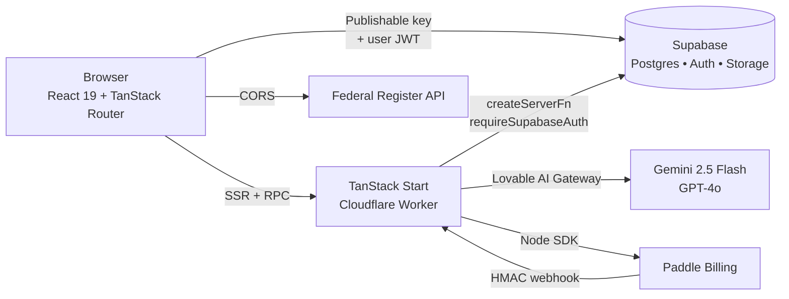
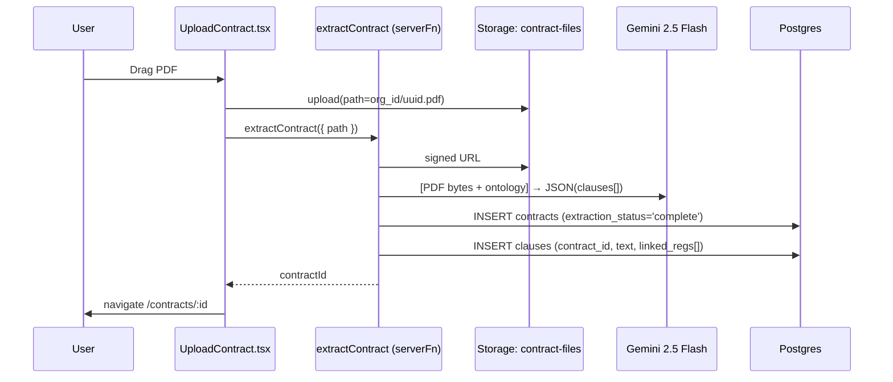
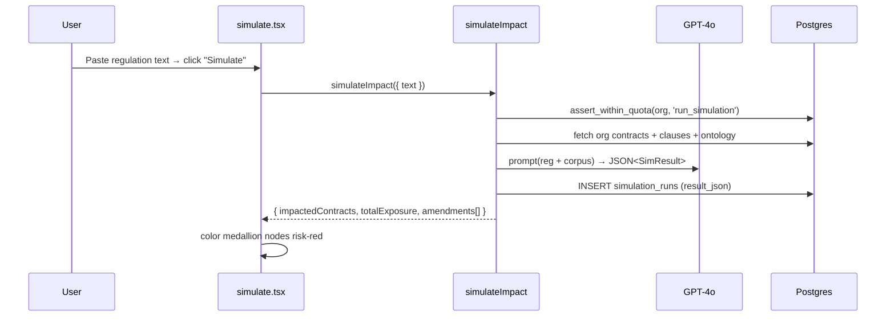
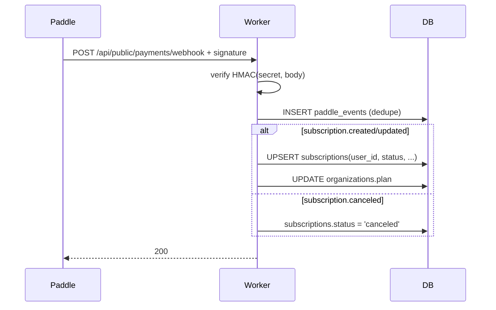
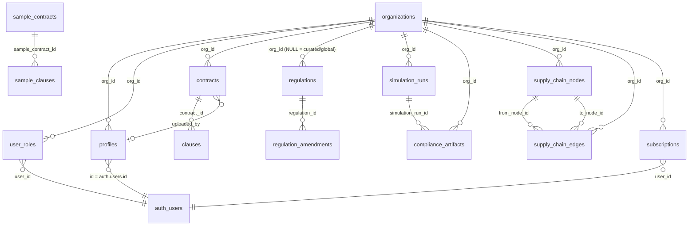

# ClauseGraph — Architecture Reference

Deep technical documentation of the ClauseGraph system: every stack, folder, table, function, route, and design token.

---

## 1. Overview

ClauseGraph is a legal-compliance intelligence platform. Users upload contracts, cite regulations, and simulate the "blast radius" of any regulation (real, hypothetical, or predicted) across their contract portfolio and their supply chain. It also generates executable compliance code (audit scripts + Terraform remediations) and end-to-end Action Plans.



---

## 2. Tech Stack

### Frontend
| Layer | Choice | Role |
|---|---|---|
| Framework | **React 19** | UI runtime |
| Meta-framework | **TanStack Start v1** | SSR, file-based routing, server functions |
| Router | **TanStack Router** | Type-safe file-based routing (`src/routes/`) |
| Data | **TanStack Query v5** | Client cache, loader integration |
| Bundler | **Vite 7** + `@tailwindcss/vite` | Dev/build |
| Language | **TypeScript strict** | Type safety |
| Styling | **Tailwind v4** (`@import` in `src/styles.css`) | Utility CSS |
| UI kit | **shadcn/ui** on **Radix primitives** | Accessible components |
| Icons | **lucide-react** | Line icons |
| Fonts | **Sora** (display) / **Manrope** (body) / **JetBrains Mono** (data) | Typography |
| Theme | Custom `theme-provider` | Light / Dark, `localStorage` persist |
| PDF | **jspdf** | Action Plan export |
| Validation | **zod** | Server-fn input validators |
| Dates | **date-fns** | Formatting |

### Backend / Platform
| Layer | Choice | Role |
|---|---|---|
| Cloud | **Lovable Cloud** (managed Supabase) | Postgres + Auth + Storage + RLS |
| RPC | **TanStack `createServerFn`** (`@tanstack/react-start`) | App-internal server logic |
| HTTP routes | **TanStack file routes** under `src/routes/api/public/*` | Webhooks, health |
| Auth broker | **`@lovable.dev/cloud-auth-js`** | Google OAuth iframe-safe |
| Auth-server middleware | `requireSupabaseAuth` | Bearer → user-scoped Supabase client |
| Admin client | `supabaseAdmin` (service role) | Verified webhooks only |
| Runtime | **Cloudflare Workers** (nodejs_compat) | SSR + server-fn host |

### AI
| Task | Model | Provider |
|---|---|---|
| Contract extraction (PDF → clauses + linked_regs) | **Gemini 2.5 Flash** | Lovable AI Gateway |
| Simulate Impact | **GPT-4o** | Lovable AI Gateway |
| Action Plan (policy + amendments + checklist) | **GPT-4o** | Lovable AI Gateway |
| Predictive amendment drafting | **GPT-4o** | Lovable AI Gateway |
| Compliance-as-Code (Python audit + Terraform fix) | **GPT-4o** | Lovable AI Gateway |

All AI calls use `LOVABLE_API_KEY` — no per-model keys.

### Billing
- **Paddle** Billing (Sandbox + Live)
- **`@paddle/paddle-node-sdk`** on the server for pro-rated swaps, subscription reads
- **Paddle.js** on the client for the checkout overlay
- Webhook: `POST /api/public/payments/webhook` with HMAC signature verification

### External
- **Federal Register API** (`api.federalregister.gov/api/v1/documents`) — live curated feed alongside the internal ontology.

---

## 3. Folder Structure

```
src/
├── router.tsx                       Root router; QueryClient wired into context
├── start.ts                         Start instance; registers functionMiddleware
├── styles.css                       All design tokens + Tailwind theme
│
├── routes/                          File-based routing
│   ├── __root.tsx                   Root layout: <html>/<head>, theme provider, auth listener
│   ├── index.tsx                    "/" — marketing / landing
│   ├── auth.tsx                     "/auth" — sign in / sign up (email + Google)
│   ├── reset-password.tsx           Password reset
│   ├── privacy.tsx, terms.tsx,      Legal pages
│   │   refund.tsx
│   ├── _authenticated/              Pathless layout — Supabase gate (ssr:false)
│   │   ├── route.tsx                Gate: getUser() → redirect(/auth) if missing
│   │   ├── dashboard.tsx            Portfolio overview + medallion
│   │   ├── contracts.tsx            Layout for contracts pages
│   │   ├── contracts.index.tsx      "/contracts" list
│   │   ├── contracts.$contractId.tsx  Contract detail with clauses
│   │   ├── feed.tsx                 Regulatory Feed (ontology + Federal Register)
│   │   ├── regulations.$regId.tsx   Regulation detail
│   │   ├── simulate.tsx             "Simulate Impact" flow
│   │   ├── backtest.tsx             Historical enforcement validation
│   │   ├── actions.tsx              Action Plan generator + PDF export
│   │   ├── predictive.tsx           Predictive Regulatory Radar
│   │   ├── predictive.$regulationId.tsx  Per-regulation forecast + hypothetical
│   │   ├── what-if.tsx              What-If Sandbox
│   │   ├── supply-chain.tsx         Cross-enterprise blast radius + Compliance-as-Code
│   │   ├── settings.account.tsx     Profile, workspace deletion (30-day grace)
│   │   ├── settings.billing.tsx     Plans, upgrade/downgrade, quotas
│   │   └── settings.team.tsx        Invite members, roles
│   └── api/public/
│       ├── health.ts                Health check
│       └── payments/webhook.ts      Paddle webhook (HMAC verified)
│
├── components/
│   ├── clausegraph/                 Product components
│   │   ├── AppShell.tsx             Fixed viewport shell, ambient background
│   │   ├── Sidebar.tsx              Hover-expanding rail (64 → 232 px)
│   │   ├── TopBar.tsx               Workspace name + "Simulate Impact" CTA
│   │   ├── GraphMedallion.tsx       Circular blast-radius radar (SVG, breathing)
│   │   ├── BlastRadiusSeal.tsx      Static seal placeholder (Phase 1 fallback)
│   │   ├── ContractCard.tsx         Glass card in contract list
│   │   ├── ClauseRow.tsx            Clause text + regulation pills
│   │   ├── RegulationPill.tsx       Brass/mint outlined regulation link
│   │   ├── JurisdictionChip.tsx     EU / US / BD tag
│   │   ├── FederalRegisterFeed.tsx  Live 5-most-recent fetch
│   │   ├── BacktestCard.tsx         Real enforcement case card
│   │   ├── ActionPlanPanel.tsx      Policy draft + amendments + checklist + PDF
│   │   ├── SupplyChainGraph.tsx     Recursive dependency graph, cascading animation
│   │   ├── ComplianceCodePanel.tsx  Terminal-style Python + Terraform viewer
│   │   ├── PlanStatusBanner.tsx     Trial countdown / plan indicator (opt-in)
│   │   └── UploadContract.tsx       Drag-drop PDF → Storage → extraction
│   └── ui/                          shadcn primitives (button, dialog, tabs, ...)
│
├── lib/                             Business logic & server functions
│   ├── simulate.functions.ts        `simulateImpact` — GPT-4o blast radius
│   ├── simulate-types.ts, simulate-fallback.ts
│   ├── action-plan.functions.ts     `generateActionPlan` — GPT-4o report
│   ├── action-plan-types.ts, action-plan-fallback.ts
│   ├── backtest.functions.ts        `runBacktest` — replay enforcement scenario
│   ├── predict.functions.ts         `predictAmendment` — heuristic + LLM draft
│   ├── supply-chain.functions.ts    `traceSupplyChain` — recursive edges walk
│   ├── compliance-code.functions.ts `generateComplianceCode` — audit + Terraform
│   ├── upload.functions.ts          `extractContract` — Gemini clause extraction
│   ├── billing.functions.ts         Paddle checkout tokens, plan swap
│   ├── account.functions.ts         Delete/cancel-delete workspace
│   ├── team.functions.ts            Invites, role changes
│   ├── paddle.ts / paddle.server.ts Paddle client + server SDK helpers
│   ├── plans.ts                     Plan → limit table
│   ├── utils.ts                     cn() + shared helpers
│   ├── error-capture.ts, error-page.ts, lovable-error-reporting.ts
│
├── data/
│   ├── types.ts                     Regulation / Contract / Amendment types
│   └── queries.ts                   TanStack Query options factories
│
├── integrations/supabase/           AUTO-GENERATED — do not edit
│   ├── client.ts                    Browser client (publishable key)
│   ├── client.server.ts             Admin (service role) — server-only
│   ├── auth-middleware.ts           requireSupabaseAuth
│   ├── auth-attacher.ts             Bearer attacher functionMiddleware
│   └── types.ts                     Database<T> generated types
│
└── hooks/
    ├── use-mobile.tsx
    └── usePaddleCheckout.ts         Paddle.js loader + checkout opener
```

---

## 4. System Architecture

```mermaid
flowchart TB
  subgraph Client
    RC[React 19 UI]
    TQ[TanStack Query]
    SBB[Browser Supabase<br/>publishable key]
  end
  subgraph Edge[Cloudflare Worker — TanStack Start]
    SSR[SSR renderer]
    SF[createServerFn handlers]
    AR[/api/public/*/ routes]
    MW1[requireSupabaseAuth<br/>middleware]
  end
  subgraph Lovable Cloud
    PG[(Postgres<br/>+ RLS)]
    AUTH[Supabase Auth]
    ST[(Storage<br/>contract-files)]
  end
  AI[[Lovable AI Gateway]]
  PAD[[Paddle Billing]]
  FR[[Federal Register API]]

  RC --> SBB --> AUTH
  RC -->|useServerFn| SF
  SF --> MW1 --> PG
  SF -.admin.-> PG
  AR -->|HMAC verified| PAD
  PAD -->|webhook| AR
  SF --> AI
  RC --> FR
  SF --> ST
```

**Three Supabase clients** — each has a distinct trust boundary:
1. **Browser client** (`@/integrations/supabase/client`) — publishable key + user session. Used for auth flows and realtime.
2. **`requireSupabaseAuth` middleware** — server-side, publishable key + bearer token. Default for user-scoped server functions. RLS applies as the caller.
3. **`supabaseAdmin`** (`client.server.ts`) — service-role, bypasses RLS. Used only inside verified webhook handlers and privileged maintenance code, loaded via dynamic `import()` inside handlers.

---

## 5. Data-Flow Walk-throughs

### 5.1 Contract Upload



### 5.2 Simulate Impact



### 5.3 Paddle Webhook



### 5.4 Quota + Trial Downgrade

`assert_within_quota(_org, _action)` runs before every gated write:
1. Read `organizations.plan` and `trial_ends_at`.
2. If plan is `pro`, trial expired, and there is no active/trialing paid subscription → downgrade to `free` (lazy).
3. Count usage vs. limit for `_action` in {`upload_contract`, `run_simulation`, `invite_teammate`}.
4. Raise `PLAN_LIMIT` if exceeded; client surfaces `PlanLimitDialog`.

### 5.5 Supply-Chain Trace

Given a starting node (usually "Your Company"), the server function walks `supply_chain_edges` recursively (depth ≤ N) accumulating `depends_on_regs` at each hop. Any node whose transitive dependency intersects the simulated regulation's ID lights up. Rendered by `SupplyChainGraph.tsx` with a cascading mint→red pulse.

---

## 6. Database — Full Reference

This section is the **authoritative schema dump**. Everything below is the real
DDL of the live database (verified against `information_schema`, `pg_policies`,
`pg_constraint`, `pg_indexes` and `pg_get_functiondef`). Running §6.3 → §6.9 in
order on an empty Supabase project reproduces the backend exactly — that is the
path used by `MIGRATION.md`.

### 6.1 ER Diagram



### 6.2 Table inventory

| Table | Purpose | Tenanted by |
|---|---|---|
| `organizations` | Workspace tenant + plan state | — (is the tenant) |
| `profiles` | 1:1 with `auth.users`, holds `org_id` | `org_id` |
| `user_roles` | Roles, kept off `profiles` on purpose | `user_id` + `org_id` |
| `contracts` | Uploaded + seeded contracts | `org_id` |
| `clauses` | Extracted clauses, cite regulation IDs | via `contract_id` |
| `regulations` | Ontology; `org_id IS NULL` = curated global | `org_id` nullable |
| `regulation_amendments` | Amendment history feeding the radar | global |
| `simulation_runs` | Persisted blast-radius runs | `org_id` |
| `compliance_artifacts` | Compliance-as-Code outputs | `org_id` |
| `supply_chain_nodes` / `_edges` | Cross-enterprise graph | `org_id` |
| `backtest_cases` | Real enforcement cases (public read) | global |
| `sample_contracts` / `sample_clauses` | Seed corpus copied into each new workspace | global |
| `subscriptions` | Paddle subscriptions (dormant while billing is parked) | `org_id` / `user_id` |
| `paddle_events` | Webhook idempotency ledger | global |

### 6.3 Enum + shared trigger helper

```sql
CREATE TYPE public.app_role AS ENUM ('admin', 'member');
```

### 6.4 Tables — DDL

```sql
-- ── Tenant ───────────────────────────────────────────────────────────────
CREATE TABLE public.organizations (
  id                     uuid PRIMARY KEY DEFAULT gen_random_uuid(),
  name                   text NOT NULL,
  plan                   text NOT NULL DEFAULT 'free',        -- free | pro | team
  plan_status            text NOT NULL DEFAULT 'active',      -- active | past_due | paused | canceled
  plan_renews_at         timestamptz,
  trial_ends_at          timestamptz,
  paddle_customer_id     text,
  stripe_customer_id     text,                                -- legacy, unused
  deletion_scheduled_at  timestamptz,
  deletion_requested_by  uuid REFERENCES auth.users(id) ON DELETE SET NULL,
  deleted_at             timestamptz,
  created_at             timestamptz NOT NULL DEFAULT now()
);
CREATE INDEX idx_org_deletion_scheduled_at ON public.organizations (deletion_scheduled_at)
  WHERE deletion_scheduled_at IS NOT NULL;

CREATE TABLE public.profiles (
  id         uuid PRIMARY KEY REFERENCES auth.users(id) ON DELETE CASCADE,
  org_id     uuid NOT NULL REFERENCES public.organizations(id) ON DELETE CASCADE,
  full_name  text,
  email      text,
  created_at timestamptz NOT NULL DEFAULT now()
);
CREATE INDEX profiles_org_id_idx ON public.profiles (org_id);

CREATE TABLE public.user_roles (
  id         uuid PRIMARY KEY DEFAULT gen_random_uuid(),
  user_id    uuid NOT NULL REFERENCES auth.users(id) ON DELETE CASCADE,
  org_id     uuid NOT NULL REFERENCES public.organizations(id) ON DELETE CASCADE,
  role       public.app_role NOT NULL,
  created_at timestamptz NOT NULL DEFAULT now(),
  UNIQUE (user_id, org_id, role)
);
CREATE INDEX user_roles_user_org_idx ON public.user_roles (user_id, org_id);

-- ── Portfolio ────────────────────────────────────────────────────────────
CREATE TABLE public.contracts (
  id                uuid PRIMARY KEY DEFAULT gen_random_uuid(),
  org_id            uuid NOT NULL REFERENCES public.organizations(id) ON DELETE CASCADE,
  name              text NOT NULL,
  counterparty      text NOT NULL,
  value             numeric NOT NULL DEFAULT 0,
  source_file_url   text,
  extraction_status text NOT NULL DEFAULT 'complete',  -- pending | complete | failed
  extraction_error  text,
  uploaded_by       uuid REFERENCES public.profiles(id) ON DELETE SET NULL,
  is_sample         boolean NOT NULL DEFAULT false,
  created_at        timestamptz NOT NULL DEFAULT now()
);
CREATE INDEX contracts_org_id_idx      ON public.contracts (org_id);
CREATE INDEX contracts_org_created_idx ON public.contracts (org_id, created_at DESC);

CREATE TABLE public.clauses (
  id          uuid PRIMARY KEY DEFAULT gen_random_uuid(),
  contract_id uuid NOT NULL REFERENCES public.contracts(id) ON DELETE CASCADE,
  text        text NOT NULL,
  linked_regs text[] NOT NULL DEFAULT '{}',
  confidence  numeric,
  position    integer NOT NULL DEFAULT 0,
  created_at  timestamptz NOT NULL DEFAULT now()
);
CREATE INDEX clauses_contract_id_idx ON public.clauses (contract_id);

-- ── Ontology ─────────────────────────────────────────────────────────────
CREATE TABLE public.regulations (
  id                 text PRIMARY KEY,                 -- e.g. 'GDPR-ART17'
  org_id             uuid REFERENCES public.organizations(id) ON DELETE CASCADE, -- NULL = curated
  jurisdiction       text NOT NULL,
  title              text NOT NULL,
  summary            text NOT NULL,
  obligations        jsonb NOT NULL DEFAULT '[]',      -- [{id, text}] (strings tolerated by the UI)
  news_signal_boost  numeric NOT NULL DEFAULT 0 CHECK (news_signal_boost BETWEEN 0 AND 1),
  created_at         timestamptz NOT NULL DEFAULT now()
);
CREATE INDEX regulations_org_id_idx ON public.regulations (org_id);

CREATE TABLE public.regulation_amendments (
  id            uuid PRIMARY KEY DEFAULT gen_random_uuid(),
  regulation_id text NOT NULL REFERENCES public.regulations(id) ON DELETE CASCADE,
  amended_on    date NOT NULL,
  summary       text NOT NULL,
  direction     text NOT NULL CHECK (direction IN ('tightened','loosened','clarified','expanded')),
  created_at    timestamptz NOT NULL DEFAULT now()
);
CREATE INDEX regulation_amendments_reg_idx ON public.regulation_amendments (regulation_id, amended_on DESC);

-- ── Simulation + artifacts ───────────────────────────────────────────────
CREATE TABLE public.simulation_runs (
  id                    uuid PRIMARY KEY DEFAULT gen_random_uuid(),
  org_id                uuid NOT NULL REFERENCES public.organizations(id) ON DELETE CASCADE,
  input_regulation_text text NOT NULL,
  result_json           jsonb NOT NULL,
  run_type              text NOT NULL DEFAULT 'reactive'
                          CHECK (run_type IN ('reactive','forecast','what_if','supply_chain')),
  triggered_by          uuid REFERENCES public.profiles(id) ON DELETE SET NULL,
  created_at            timestamptz NOT NULL DEFAULT now()
);
CREATE INDEX simulation_runs_org_created_idx ON public.simulation_runs (org_id, created_at DESC);

CREATE TABLE public.compliance_artifacts (
  id                uuid PRIMARY KEY DEFAULT gen_random_uuid(),
  org_id            uuid NOT NULL REFERENCES public.organizations(id) ON DELETE CASCADE,
  regulation_id     text,
  simulation_run_id uuid REFERENCES public.simulation_runs(id) ON DELETE SET NULL,
  gap               text NOT NULL,
  stack             text NOT NULL CHECK (stack IN ('aws','gcp','azure')),
  audit_script      jsonb NOT NULL,
  remediation       jsonb NOT NULL,
  runbook           text,
  test_cases        text[] NOT NULL DEFAULT '{}',
  created_by        uuid REFERENCES auth.users(id) ON DELETE SET NULL,
  created_at        timestamptz NOT NULL DEFAULT now()
);

-- ── Cross-enterprise graph ───────────────────────────────────────────────
CREATE TABLE public.supply_chain_nodes (
  id           uuid PRIMARY KEY DEFAULT gen_random_uuid(),
  org_id       uuid NOT NULL REFERENCES public.organizations(id) ON DELETE CASCADE,
  name         text NOT NULL,
  role         text NOT NULL CHECK (role IN ('self','supplier','subprocessor','vendor')),
  tier         integer NOT NULL DEFAULT 0,
  jurisdiction text,
  description  text,
  created_at   timestamptz NOT NULL DEFAULT now()
);

CREATE TABLE public.supply_chain_edges (
  id              uuid PRIMARY KEY DEFAULT gen_random_uuid(),
  org_id          uuid NOT NULL REFERENCES public.organizations(id) ON DELETE CASCADE,
  from_node_id    uuid NOT NULL REFERENCES public.supply_chain_nodes(id) ON DELETE CASCADE,
  to_node_id      uuid NOT NULL REFERENCES public.supply_chain_nodes(id) ON DELETE CASCADE,
  contract_name   text NOT NULL,
  contract_value  numeric NOT NULL DEFAULT 0,
  key_clauses     text[] NOT NULL DEFAULT '{}',
  depends_on_regs text[] NOT NULL DEFAULT '{}',
  created_at      timestamptz NOT NULL DEFAULT now()
);

-- ── Reference corpora ────────────────────────────────────────────────────
CREATE TABLE public.backtest_cases (
  id                    text PRIMARY KEY,
  company               text NOT NULL,
  fine_usd              numeric NOT NULL,
  case_date             date NOT NULL,
  regulation            text NOT NULL,
  summary               text NOT NULL,
  source                text NOT NULL,
  reconstructed_prompt  text NOT NULL,
  reconstructed_clauses jsonb NOT NULL,
  fallback              jsonb NOT NULL,
  position              integer NOT NULL DEFAULT 0,
  created_at            timestamptz NOT NULL DEFAULT now()
);

CREATE TABLE public.sample_contracts (
  id           text PRIMARY KEY,
  name         text NOT NULL,
  counterparty text NOT NULL,
  value        numeric NOT NULL,
  position     integer NOT NULL DEFAULT 0
);

CREATE TABLE public.sample_clauses (
  id                 text PRIMARY KEY,
  sample_contract_id text NOT NULL REFERENCES public.sample_contracts(id) ON DELETE CASCADE,
  text               text NOT NULL,
  linked_regs        text[] NOT NULL DEFAULT '{}',
  position           integer NOT NULL DEFAULT 0
);

-- ── Billing (dormant while billing is parked) ────────────────────────────
CREATE TABLE public.subscriptions (
  id                     uuid PRIMARY KEY DEFAULT gen_random_uuid(),
  user_id                uuid NOT NULL REFERENCES auth.users(id) ON DELETE CASCADE,
  org_id                 uuid REFERENCES public.organizations(id) ON DELETE CASCADE,
  paddle_subscription_id text NOT NULL UNIQUE,
  paddle_customer_id     text NOT NULL,
  product_id             text NOT NULL,
  price_id               text NOT NULL,
  status                 text NOT NULL DEFAULT 'active',
  current_period_start   timestamptz,
  current_period_end     timestamptz,
  cancel_at_period_end   boolean DEFAULT false,
  environment            text NOT NULL DEFAULT 'sandbox',   -- sandbox | live
  created_at             timestamptz NOT NULL DEFAULT now(),
  updated_at             timestamptz NOT NULL DEFAULT now()
);
CREATE INDEX idx_subscriptions_user_id   ON public.subscriptions (user_id);
CREATE INDEX idx_subscriptions_org_id    ON public.subscriptions (org_id);
CREATE INDEX idx_subscriptions_paddle_id ON public.subscriptions (paddle_subscription_id);

CREATE TABLE public.paddle_events (
  event_id    text PRIMARY KEY,
  event_type  text NOT NULL,
  received_at timestamptz NOT NULL DEFAULT now()
);
```

### 6.5 GRANTs (mandatory — RLS alone is not enough)

```sql
-- Tenanted, user-writable tables
GRANT SELECT, INSERT, UPDATE, DELETE ON
  public.contracts, public.clauses, public.regulations,
  public.simulation_runs, public.compliance_artifacts,
  public.supply_chain_nodes, public.supply_chain_edges
TO authenticated;

-- Read-mostly tables
GRANT SELECT ON public.organizations, public.profiles, public.user_roles,
                public.regulation_amendments, public.backtest_cases,
                public.sample_contracts, public.sample_clauses,
                public.subscriptions TO authenticated;
GRANT UPDATE ON public.organizations, public.profiles TO authenticated;
GRANT INSERT, DELETE ON public.user_roles TO authenticated;

-- Public (unauthenticated) reads: curated ontology + enforcement library only
GRANT SELECT ON public.regulations, public.backtest_cases TO anon;

-- Server-side / webhook writes
GRANT ALL ON ALL TABLES IN SCHEMA public TO service_role;
```

### 6.6 RLS — every policy, verbatim

```sql
ALTER TABLE public.organizations         ENABLE ROW LEVEL SECURITY;
ALTER TABLE public.profiles              ENABLE ROW LEVEL SECURITY;
ALTER TABLE public.user_roles            ENABLE ROW LEVEL SECURITY;
ALTER TABLE public.contracts             ENABLE ROW LEVEL SECURITY;
ALTER TABLE public.clauses               ENABLE ROW LEVEL SECURITY;
ALTER TABLE public.regulations           ENABLE ROW LEVEL SECURITY;
ALTER TABLE public.regulation_amendments ENABLE ROW LEVEL SECURITY;
ALTER TABLE public.simulation_runs       ENABLE ROW LEVEL SECURITY;
ALTER TABLE public.compliance_artifacts  ENABLE ROW LEVEL SECURITY;
ALTER TABLE public.supply_chain_nodes    ENABLE ROW LEVEL SECURITY;
ALTER TABLE public.supply_chain_edges    ENABLE ROW LEVEL SECURITY;
ALTER TABLE public.backtest_cases        ENABLE ROW LEVEL SECURITY;
ALTER TABLE public.sample_contracts      ENABLE ROW LEVEL SECURITY;
ALTER TABLE public.sample_clauses        ENABLE ROW LEVEL SECURITY;
ALTER TABLE public.subscriptions         ENABLE ROW LEVEL SECURITY;
ALTER TABLE public.paddle_events         ENABLE ROW LEVEL SECURITY; -- service_role only, no policies

-- organizations
CREATE POLICY "Members read own org" ON public.organizations
  FOR SELECT TO authenticated USING (id = public.current_org_id());
CREATE POLICY "Admins update own org" ON public.organizations
  FOR UPDATE TO authenticated
  USING (public.has_role(auth.uid(), id, 'admin'))
  WITH CHECK (public.has_role(auth.uid(), id, 'admin'));

-- profiles
CREATE POLICY "Read profiles in own org" ON public.profiles
  FOR SELECT TO authenticated
  USING (id = auth.uid() OR org_id = public.current_org_id());
CREATE POLICY "Update own profile" ON public.profiles
  FOR UPDATE TO authenticated USING (id = auth.uid()) WITH CHECK (id = auth.uid());

-- user_roles
CREATE POLICY "Read roles in own org" ON public.user_roles
  FOR SELECT TO authenticated USING (org_id = public.current_org_id());
CREATE POLICY "Admins insert roles in org" ON public.user_roles
  FOR INSERT TO authenticated WITH CHECK (public.has_role(auth.uid(), org_id, 'admin'));
CREATE POLICY "Admins delete roles in org" ON public.user_roles
  FOR DELETE TO authenticated USING (public.has_role(auth.uid(), org_id, 'admin'));

-- contracts (same 4-policy shape for regulations, supply_chain_nodes, supply_chain_edges)
CREATE POLICY "Members read own org contracts"   ON public.contracts
  FOR SELECT TO authenticated USING (org_id = public.current_org_id());
CREATE POLICY "Members insert own org contracts" ON public.contracts
  FOR INSERT TO authenticated WITH CHECK (org_id = public.current_org_id());
CREATE POLICY "Members update own org contracts" ON public.contracts
  FOR UPDATE TO authenticated USING (org_id = public.current_org_id())
  WITH CHECK (org_id = public.current_org_id());
CREATE POLICY "Members delete own org contracts" ON public.contracts
  FOR DELETE TO authenticated USING (org_id = public.current_org_id());

-- clauses: tenanted through their parent contract
CREATE POLICY "Members read own org clauses" ON public.clauses
  FOR SELECT TO authenticated USING (EXISTS (
    SELECT 1 FROM public.contracts c
    WHERE c.id = clauses.contract_id AND c.org_id = public.current_org_id()));
-- ... identical EXISTS predicate for INSERT (WITH CHECK), UPDATE and DELETE.

-- regulations: curated rows (org_id IS NULL) are world-readable
CREATE POLICY "Read curated or own org regs" ON public.regulations
  FOR SELECT USING (org_id IS NULL OR org_id = public.current_org_id());

-- simulation_runs (insert + read only; runs are an audit log, never edited)
CREATE POLICY "Members read own org sims"   ON public.simulation_runs
  FOR SELECT TO authenticated USING (org_id = public.current_org_id());
CREATE POLICY "Members insert own org sims" ON public.simulation_runs
  FOR INSERT TO authenticated WITH CHECK (org_id = public.current_org_id());

-- compliance_artifacts (read / insert / delete)
CREATE POLICY "org members read artifacts"   ON public.compliance_artifacts
  FOR SELECT TO authenticated USING (org_id = public.current_org_id());
CREATE POLICY "org members insert artifacts" ON public.compliance_artifacts
  FOR INSERT TO authenticated WITH CHECK (org_id = public.current_org_id());
CREATE POLICY "org members delete artifacts" ON public.compliance_artifacts
  FOR DELETE TO authenticated USING (org_id = public.current_org_id());

-- reference corpora
CREATE POLICY "Anyone can read backtest cases" ON public.backtest_cases
  FOR SELECT USING (true);
CREATE POLICY "Authenticated can read sample contracts" ON public.sample_contracts
  FOR SELECT TO authenticated USING (true);
CREATE POLICY "Authenticated can read sample clauses" ON public.sample_clauses
  FOR SELECT TO authenticated USING (true);
CREATE POLICY "Any authenticated user can read amendment history"
  ON public.regulation_amendments FOR SELECT TO authenticated USING (true);

-- subscriptions: read-only to the owner/org; every write is service_role
CREATE POLICY "subscriptions: self read" ON public.subscriptions
  FOR SELECT TO authenticated
  USING (user_id = auth.uid() OR org_id = public.current_org_id());
```

### 6.7 Functions — full source

```sql
-- Role check. SECURITY DEFINER so RLS on user_roles can't recurse.
CREATE OR REPLACE FUNCTION public.has_role(_user_id uuid, _org_id uuid, _role app_role)
RETURNS boolean LANGUAGE sql STABLE SECURITY DEFINER SET search_path = public AS $$
  SELECT EXISTS (SELECT 1 FROM public.user_roles
                 WHERE user_id = _user_id AND org_id = _org_id AND role = _role)
$$;

-- The single tenancy predicate used by nearly every policy.
CREATE OR REPLACE FUNCTION public.current_org_id()
RETURNS uuid LANGUAGE sql STABLE SECURITY DEFINER SET search_path = public AS $$
  SELECT org_id FROM public.profiles WHERE id = auth.uid() LIMIT 1
$$;

-- MASTER SWITCH. false = billing parked: everyone is Pro, no quota can fire.
-- Flip to `SELECT true` (and set src/lib/plans.ts BILLING_ENABLED = true) to
-- turn paid plans back on. Nothing else needs to change.
CREATE OR REPLACE FUNCTION public.billing_enabled()
RETURNS boolean LANGUAGE sql IMMUTABLE SET search_path = public AS $$ SELECT false $$;

-- Effective plan, resolved server-side so reads and writes can never disagree.
CREATE OR REPLACE FUNCTION public.resolve_org_plan(_org uuid)
RETURNS text LANGUAGE plpgsql SECURITY DEFINER SET search_path = public AS $$
DECLARE v_plan text; v_trial_ends timestamptz; v_has_paid boolean;
BEGIN
  SELECT plan, trial_ends_at INTO v_plan, v_trial_ends
    FROM public.organizations WHERE id = _org;
  IF v_plan IS NULL THEN RETURN NULL; END IF;

  -- Billing paused: every workspace is Pro, nothing expires.
  IF NOT public.billing_enabled() THEN
    IF v_plan <> 'pro' OR v_trial_ends IS NOT NULL THEN
      UPDATE public.organizations
        SET plan = 'pro', plan_status = 'active', trial_ends_at = NULL
        WHERE id = _org;
    END IF;
    RETURN 'pro';
  END IF;

  -- Billing live: expire a lapsed trial unless a paid subscription backs it.
  IF v_trial_ends IS NOT NULL AND v_trial_ends < now() THEN
    SELECT EXISTS (
      SELECT 1 FROM public.subscriptions s
      WHERE (s.org_id = _org OR s.user_id IN (SELECT id FROM public.profiles WHERE org_id = _org))
        AND s.status IN ('active','trialing','past_due')
        AND (s.current_period_end IS NULL OR s.current_period_end > now())
    ) INTO v_has_paid;
    IF NOT v_has_paid THEN
      UPDATE public.organizations
        SET plan = 'free', plan_status = 'active', trial_ends_at = NULL WHERE id = _org;
      v_plan := 'free';
    ELSE
      UPDATE public.organizations SET trial_ends_at = NULL WHERE id = _org;
    END IF;
  END IF;

  RETURN v_plan;
END; $$;

-- Usage counters shown on Settings → Billing.
CREATE OR REPLACE FUNCTION public.get_org_usage(_org uuid)
RETURNS TABLE(contracts integer, simulations integer, members integer)
LANGUAGE sql STABLE SECURITY DEFINER SET search_path = public AS $$
  SELECT
    (SELECT count(*)::int FROM public.contracts WHERE org_id = _org AND is_sample = false),
    (SELECT count(*)::int FROM public.simulation_runs
       WHERE org_id = _org AND created_at >= date_trunc('month', now())),
    (SELECT count(*)::int FROM public.profiles WHERE org_id = _org);
$$;

-- Quota gate. Returns immediately while billing is parked.
CREATE OR REPLACE FUNCTION public.assert_within_quota(_org uuid, _action text)
RETURNS void LANGUAGE plpgsql SECURITY DEFINER SET search_path = public AS $$
DECLARE v_plan text; v_count int; v_limit int;
BEGIN
  IF NOT public.billing_enabled() THEN RETURN; END IF;

  v_plan := public.resolve_org_plan(_org);
  IF v_plan IS NULL THEN RAISE EXCEPTION 'organization not found'; END IF;

  IF _action = 'upload_contract' THEN
    SELECT count(*) INTO v_count FROM public.contracts WHERE org_id = _org AND is_sample = false;
    v_limit := CASE v_plan WHEN 'free' THEN 3 WHEN 'pro' THEN 50 ELSE 1000000 END;
  ELSIF _action = 'run_simulation' THEN
    SELECT count(*) INTO v_count FROM public.simulation_runs
      WHERE org_id = _org AND created_at >= date_trunc('month', now());
    v_limit := CASE v_plan WHEN 'free' THEN 5 WHEN 'pro' THEN 100 ELSE 1000000 END;
  ELSIF _action = 'invite_teammate' THEN
    SELECT count(*) INTO v_count FROM public.profiles WHERE org_id = _org;
    v_limit := CASE v_plan WHEN 'free' THEN 1 WHEN 'pro' THEN 3 ELSE 1000000 END;
  ELSIF _action IN ('generate_action_plan','generate_compliance_code') THEN
    SELECT count(*) INTO v_count FROM public.simulation_runs
      WHERE org_id = _org AND created_at >= date_trunc('month', now());
    v_limit := CASE v_plan WHEN 'free' THEN 0 WHEN 'pro' THEN 100 ELSE 1000000 END;
  ELSE
    RAISE EXCEPTION 'unknown quota action: %', _action;
  END IF;

  IF v_count >= v_limit THEN
    RAISE EXCEPTION 'PLAN_LIMIT: % (used %/%, plan %)', _action, v_count, v_limit, v_plan
      USING HINT = 'PLAN_LIMIT';
  END IF;
END; $$;

-- Admin-gated 30-day soft delete.
CREATE OR REPLACE FUNCTION public.request_workspace_deletion(_org uuid, _by uuid)
RETURNS timestamptz LANGUAGE plpgsql SECURITY DEFINER SET search_path = public AS $$
DECLARE v_when timestamptz;
BEGIN
  IF NOT public.has_role(_by, _org, 'admin') THEN
    RAISE EXCEPTION 'FORBIDDEN: only admins can delete a workspace';
  END IF;
  v_when := now() + interval '30 days';
  UPDATE public.organizations
    SET deletion_scheduled_at = v_when, deletion_requested_by = _by WHERE id = _org;
  RETURN v_when;
END; $$;

CREATE OR REPLACE FUNCTION public.cancel_workspace_deletion(_org uuid, _by uuid)
RETURNS void LANGUAGE plpgsql SECURITY DEFINER SET search_path = public AS $$
BEGIN
  IF NOT public.has_role(_by, _org, 'admin') THEN
    RAISE EXCEPTION 'FORBIDDEN: only admins can cancel deletion';
  END IF;
  UPDATE public.organizations
    SET deletion_scheduled_at = NULL, deletion_requested_by = NULL WHERE id = _org;
END; $$;
```

`seed_supply_chain(_org)` — idempotent seed of 6 nodes / 5 edges (Your Company →
Northwind Cloud → Meridian DataCenters → Rheinstrom Energy, and Your Company →
Paylane Processor → GlobalCard Network) with real regulation dependencies
(`GDPR-ART44`, `EU-CSRD`, `EU-DATA-CENTER-ENERGY`, `PCI-DSS`). Full source is in
the migration history and is reproduced in `MIGRATION.md`.

### 6.8 Signup trigger

```sql
-- Provisions the whole workspace on first sign-up.
CREATE OR REPLACE FUNCTION public.handle_new_user()
RETURNS trigger LANGUAGE plpgsql SECURITY DEFINER SET search_path = public AS $$
DECLARE
  new_org_id uuid; invited_org_id uuid; local_part text; ws_name text;
  s_contract record; new_contract_id uuid; v_trial timestamptz;
BEGIN
  -- Billing paused: provision Pro outright, with no trial expiry.
  v_trial := CASE WHEN public.billing_enabled() THEN now() + interval '30 days' ELSE NULL END;

  invited_org_id := NULLIF((NEW.raw_user_meta_data->>'invited_org_id')::text, '')::uuid;
  IF invited_org_id IS NOT NULL
     AND EXISTS (SELECT 1 FROM public.organizations WHERE id = invited_org_id) THEN
    INSERT INTO public.profiles (id, org_id, full_name, email)
      VALUES (NEW.id, invited_org_id, NEW.raw_user_meta_data->>'full_name', NEW.email);
    INSERT INTO public.user_roles (user_id, org_id, role)
      VALUES (NEW.id, invited_org_id, 'member');
    RETURN NEW;
  END IF;

  local_part := split_part(COALESCE(NEW.email, 'user'), '@', 1);
  ws_name := local_part || '''s workspace';

  INSERT INTO public.organizations (name, plan, plan_status, trial_ends_at)
    VALUES (ws_name, 'pro', 'active', v_trial) RETURNING id INTO new_org_id;
  INSERT INTO public.profiles (id, org_id, full_name, email)
    VALUES (NEW.id, new_org_id, NEW.raw_user_meta_data->>'full_name', NEW.email);
  INSERT INTO public.user_roles (user_id, org_id, role)
    VALUES (NEW.id, new_org_id, 'admin');

  FOR s_contract IN SELECT * FROM public.sample_contracts ORDER BY position LOOP
    INSERT INTO public.contracts (org_id, name, counterparty, value,
                                  extraction_status, is_sample, uploaded_by)
    VALUES (new_org_id, s_contract.name, s_contract.counterparty, s_contract.value,
            'complete', true, NEW.id)
    RETURNING id INTO new_contract_id;

    INSERT INTO public.clauses (contract_id, text, linked_regs, position, confidence)
    SELECT new_contract_id, sc.text, sc.linked_regs, sc.position, 1.0
    FROM public.sample_clauses sc
    WHERE sc.sample_contract_id = s_contract.id ORDER BY sc.position;
  END LOOP;

  PERFORM public.seed_supply_chain(new_org_id);
  RETURN NEW;
END; $$;

CREATE TRIGGER on_auth_user_created
  AFTER INSERT ON auth.users
  FOR EACH ROW EXECUTE FUNCTION public.handle_new_user();
```

This is the **only** trigger the app owns; everything else listed in
`pg_trigger` belongs to Supabase's own `storage` / `realtime` schemas.

### 6.9 Storage

Bucket **`contract-files`** — private. Object keys are `<org_id>/<uuid>.pdf`.
Uploads go through the browser client; reads use short-lived signed URLs minted
inside the `extractContract` server function. No public bucket exists.

```sql
INSERT INTO storage.buckets (id, name, public) VALUES ('contract-files', 'contract-files', false);
```


---

## 7. Auth & Multi-Tenancy

- **Providers**: email/password (Supabase native) + **Google OAuth via the Lovable broker** (`lovable.auth.signInWithOAuth('google', { redirect_uri: window.location.origin })`) — iframe-safe in the editor preview.
- **Route gate**: `src/routes/_authenticated/route.tsx` (`ssr: false`) calls `supabase.auth.getUser()` and redirects to `/auth` when missing. Every protected route sits under this layout — no per-route guards.
- **Tenant isolation**: `profiles.org_id` is the source of truth. `current_org_id()` is the primary RLS predicate. Cross-org access is impossible for `authenticated`.
- **Roles**: `user_roles(user_id, org_id, role)` — never store roles on `profiles`. `has_role()` is `SECURITY DEFINER` to avoid RLS recursion.
- **Entitlement**: while billing is parked every workspace is provisioned `pro` with `trial_ends_at = NULL`, and `resolve_org_plan()` keeps it there. Nothing expires and no quota can fire.
- **Bearer**: `src/start.ts` registers `attachSupabaseAuth` in `functionMiddleware`; every `createServerFn` call carries the Supabase JWT automatically.

---

## 8. Billing & Entitlements — currently PARKED

> **Status: subscriptions are built, wired and switched off.** Every workspace
> runs on Pro with unlimited usage. Nothing charges, nothing expires, no upgrade
> prompt is ever shown. The Paddle integration is kept intact so it can be
> switched on later without a rebuild.

### The two switches

| Switch | Location | Parked value |
|---|---|---|
| Database | `public.billing_enabled()` | `SELECT false` |
| Frontend | `BILLING_ENABLED` in `src/lib/plans.ts` | `false` |

Flip **both** to `true` to go commercial. Effects of the parked state:

- `handle_new_user` provisions `plan='pro'`, `trial_ends_at=NULL`.
- `resolve_org_plan` returns `'pro'` for every org and self-heals any row that drifted.
- `assert_within_quota` returns immediately — `PLAN_LIMIT` can never be raised.
- `getOrgUsage` reports `plan='pro'`, unlimited limits, no trial clock.
- `/settings/billing` renders the "Early access — nothing to pay" panel instead of pricing cards.
- `PlanLimitDialog` and the trial/dunning banners are suppressed (only scheduled-deletion warnings still show).
- The landing page prices every tier at `$0`.

### Kept for later (dormant, still correct)

- **Products / prices** in Paddle Sandbox and Live; catalog synced on publish.
- **Client**: Paddle.js loaded on demand by `usePaddleCheckout`.
- **Server**: `@paddle/paddle-node-sdk` for pro-rated plan swaps (`billing.functions.ts::changeSubscriptionPlan`) and customer-portal sessions.
- **Webhook**: `POST /api/public/payments/webhook` — HMAC verified with `PAYMENTS_SANDBOX_WEBHOOK_SECRET` / `PAYMENTS_LIVE_WEBHOOK_SECRET`, deduped through `paddle_events(event_id)`, environment-scoped writes.

### Plan matrix (applies only once billing is enabled)

| Plan | Contracts | Simulations / month | Members | Price |
|---|---|---|---|---|
| Free | 3 | 5 | 1 | $0 |
| Pro | 50 | 100 | 3 | $49 / mo |
| Team | ∞ | ∞ | ∞ | $199 / mo |

Enforced by `public.assert_within_quota` at the DB layer — bypassing the client cannot exceed the limit.

Dunning: `past_due` keeps read access but blocks quota-bumped actions; a banner surfaces it.

Soft-delete: `request_workspace_deletion` schedules deletion 30 days out and stays cancellable by admins — **active regardless of billing state**.


---

## 9. AI Pipelines

| Function | Model | Input contract | Output contract |
|---|---|---|---|
| `extractContract` | Gemini 2.5 Flash | PDF bytes + ontology JSON | `{ name, counterparty, value, clauses: [{text, linked_regs[]}] }` |
| `simulateImpact` | GPT-4o | Regulation text + org contracts + ontology | `{ impactedContracts: [{id, severity, reasoning, amendment}], totalExposureUsd }` |
| `generateActionPlan` | GPT-4o | Simulation result + org context | `{ policyDraft, amendments[], techChecklist[], timelineWeeks }` |
| `predictAmendment` | GPT-4o | Historical `regulation_amendments` + target regulation | `{ hypotheticalText, likelihood, monthsAhead }` |
| `generateComplianceCode` | GPT-4o | Regulation gap + stack (e.g. "AWS + PostgreSQL") | `{ auditScript: {language, code}, remediation: {language, code}, runbook, testCases[] }` |

Every AI call has a **fallback**: deterministic JSON (`simulate-fallback.ts`, `action-plan-fallback.ts`, `backtest_cases.fallback`) is returned if the LLM errors or returns unparseable JSON. Users never see a raw failure.

---

## 10. Design System — Obsidian & Mint

**Palette** (from `src/styles.css`):

| Token | Value | Use |
|---|---|---|
| `--bg-obsidian` | `#07090C` | Root background |
| `--surface-glass` | `rgba(255,255,255,0.04)` + `backdrop-blur(20px)` | Panels |
| `--surface-raised` | `#0F1216` | Solid backing under glass |
| `--mint` | `#5EEAD4` | Single accent — active states, primary CTA, radar pulse |
| `--risk-red` | `#E1524B` | Reserved for exposure/severity states |
| `--text-primary` | `#F2F0EA` (warm off-white) | Body text |
| `--text-muted` | `#9C978E` | Secondary/captions |
| `--hairline` | `rgba(94,234,212,0.14)` | Dividers |

**Typography**: Sora (display) / Manrope (UI) / JetBrains Mono (IDs, dollars, timestamps — "the system's citation").

**Radii**: 20px on major panels, 12px on nested elements. No mixing.

**Motion**: 150–200ms ease-out on hover/press. The only decorative animation is the medallion breathing pulse + risk cascade.

**Glass**: 1px `--hairline` border, `--surface-glass` fill, soft outer glow (not a hard shadow).

**Sidebar rail**: fixed 64 px, hover-expands to 232 px, overlays content (no reflow). Active item indicated by a 4 px mint edge line — never a filled box.

**Themes**: `theme-provider` toggles `data-theme="light|dark"`; dark is the default.

---

## 11. Routing Map

| URL | File | Auth | Purpose |
|---|---|---|---|
| `/` | `routes/index.tsx` | public | Landing |
| `/auth` | `routes/auth.tsx` | public | Sign in / up |
| `/reset-password` | `routes/reset-password.tsx` | public | Password reset |
| `/privacy`, `/terms`, `/refund` | ... | public | Legal |
| `/dashboard` | `_authenticated/dashboard.tsx` | user | Portfolio + medallion |
| `/contracts` | `_authenticated/contracts.index.tsx` | user | List |
| `/contracts/:contractId` | `contracts.$contractId.tsx` | user | Detail |
| `/feed` | `feed.tsx` | user | Ontology + Federal Register |
| `/regulations/:regId` | `regulations.$regId.tsx` | user | Regulation detail |
| `/simulate` | `simulate.tsx` | user | Simulate Impact |
| `/backtest` | `backtest.tsx` | user | Historical validation |
| `/actions` | `actions.tsx` | user | Action Plan + PDF |
| `/predictive` | `predictive.tsx` | user | Radar |
| `/predictive/:regulationId` | `predictive.$regulationId.tsx` | user | Forecast detail |
| `/what-if` | `what-if.tsx` | user | Hypothetical sandbox |
| `/supply-chain` | `supply-chain.tsx` | user | Cross-enterprise + Compliance-as-Code |
| `/settings/account` | `settings.account.tsx` | user | Profile + delete workspace |
| `/settings/billing` | `settings.billing.tsx` | user | Plan + usage |
| `/settings/team` | `settings.team.tsx` | user | Invites + roles |
| `/api/public/health` | `api/public/health.ts` | public | Health |
| `/api/public/payments/webhook` | `api/public/payments/webhook.ts` | public + HMAC | Paddle |

---

## 12. Environment & Secrets

Server-only (never exposed to browser):

| Secret | Purpose |
|---|---|
| `LOVABLE_API_KEY` | Lovable AI Gateway |
| `PADDLE_SANDBOX_API_KEY`, `PADDLE_LIVE_API_KEY` | Paddle Node SDK |
| `PAYMENTS_SANDBOX_WEBHOOK_SECRET`, `PAYMENTS_LIVE_WEBHOOK_SECRET` | Webhook HMAC |
| `SUPABASE_URL`, `SUPABASE_PUBLISHABLE_KEY` | Server publishable client |
| `SUPABASE_SERVICE_ROLE_KEY` | Managed by Lovable Cloud — not user-fetchable |
| `SUPABASE_DB_URL` | Managed by Lovable Cloud |

Client-visible (`import.meta.env`):

- `VITE_SUPABASE_URL`
- `VITE_SUPABASE_PUBLISHABLE_KEY`
- `VITE_SUPABASE_PROJECT_ID`

---

## 13. Build, Dev, Deploy

- `bun run dev` → Vite dev on `:8080`.
- `bun run build` / `bun run build:dev` → production/prerender build against the Cloudflare Worker target.
- Deploy is one-click via Lovable → Cloudflare. Stable URLs:
  - `project--<id>.lovable.app` (published)
  - `project--<id>-dev.lovable.app` (preview)
- `/api/public/*` bypasses the published-site auth wall — always verify caller identity in the handler.

---

## 14. Known Constraints

- **No Node-only libraries.** `child_process`, `sharp`, `puppeteer`, `fs.watch` are stubbed or missing on Workers. Prefer WASM / pure-JS.
- **`process.env`** must be read inside handlers, never at module scope.
- **RLS + GRANT** are mandatory together — new tables without GRANTs return `permission denied` at runtime even with correct policies.
- **`_authenticated` layout uses `ssr:false`** because Supabase stores the session in `localStorage`; server-side gating would loop on hard refresh.
