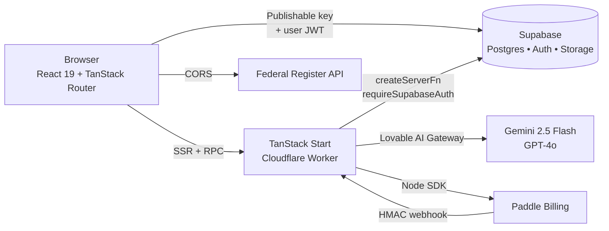
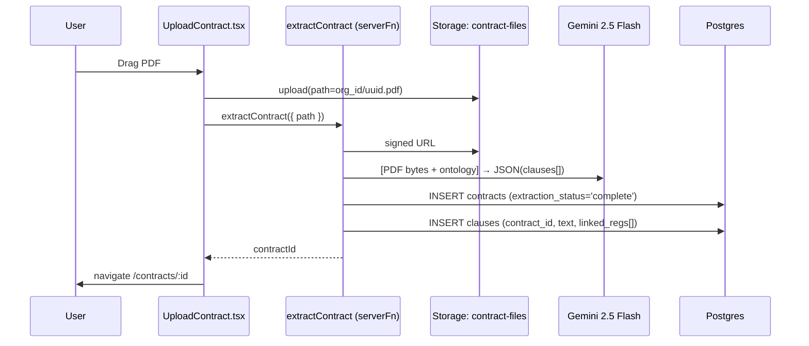
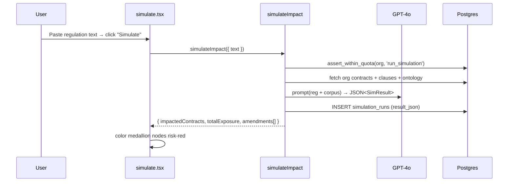
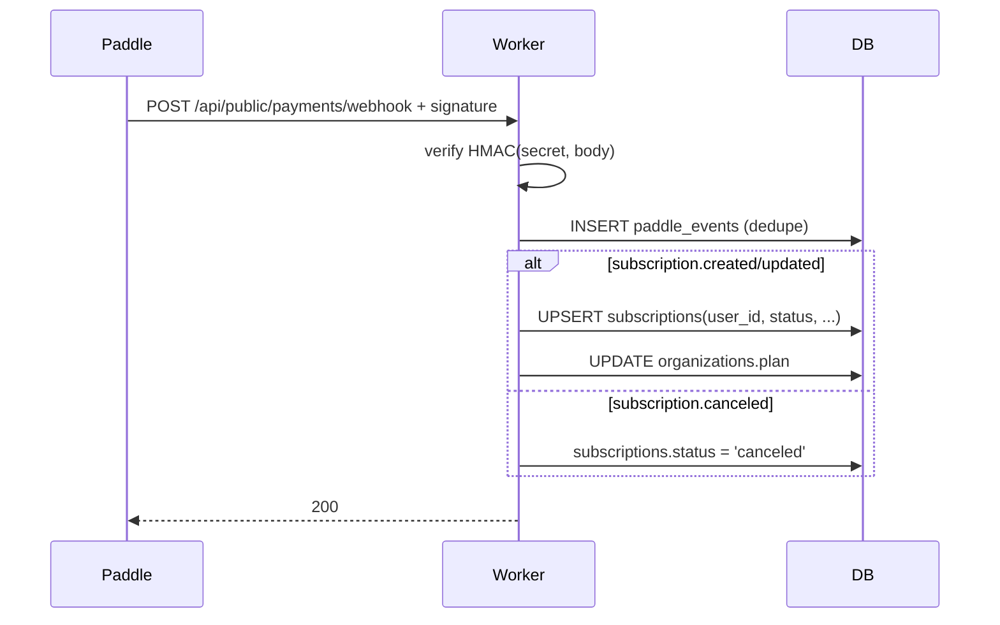
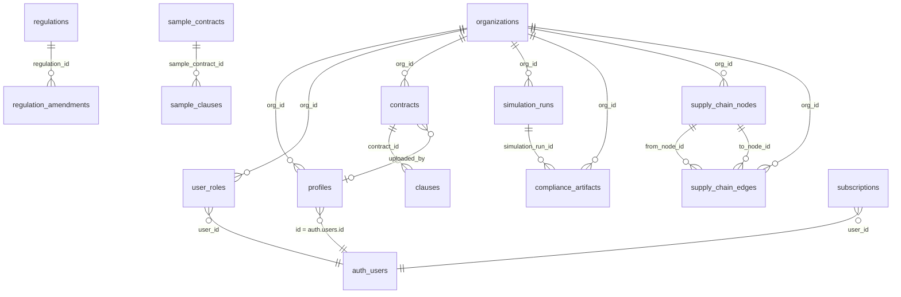

# ClauseGraph — Architecture Reference

Deep technical documentation of the ClauseGraph system: every stack, folder, table, function, route, and design token.

---

## 1. Overview

ClauseGraph is a legal-compliance intelligence platform. Users upload contracts, cite regulations, and simulate the "blast radius" of any regulation (real, hypothetical, or predicted) across their contract portfolio and their supply chain. It also generates executable compliance code (audit scripts + Terraform remediations) and end-to-end Action Plans.



---

## 2. Tech Stack

### Frontend
| Layer | Choice | Role |
|---|---|---|
| Framework | **React 19** | UI runtime |
| Meta-framework | **TanStack Start v1** | SSR, file-based routing, server functions |
| Router | **TanStack Router** | Type-safe file-based routing (`src/routes/`) |
| Data | **TanStack Query v5** | Client cache, loader integration |
| Bundler | **Vite 7** + `@tailwindcss/vite` | Dev/build |
| Language | **TypeScript strict** | Type safety |
| Styling | **Tailwind v4** (`@import` in `src/styles.css`) | Utility CSS |
| UI kit | **shadcn/ui** on **Radix primitives** | Accessible components |
| Icons | **lucide-react** | Line icons |
| Fonts | **Sora** (display) / **Manrope** (body) / **JetBrains Mono** (data) | Typography |
| Theme | Custom `theme-provider` | Light / Dark, `localStorage` persist |
| PDF | **jspdf** | Action Plan export |
| Validation | **zod** | Server-fn input validators |
| Dates | **date-fns** | Formatting |

### Backend / Platform
| Layer | Choice | Role |
|---|---|---|
| Cloud | **Lovable Cloud** (managed Supabase) | Postgres + Auth + Storage + RLS |
| RPC | **TanStack `createServerFn`** (`@tanstack/react-start`) | App-internal server logic |
| HTTP routes | **TanStack file routes** under `src/routes/api/public/*` | Webhooks, health |
| Auth broker | **`@lovable.dev/cloud-auth-js`** | Google OAuth iframe-safe |
| Auth-server middleware | `requireSupabaseAuth` | Bearer → user-scoped Supabase client |
| Admin client | `supabaseAdmin` (service role) | Verified webhooks only |
| Runtime | **Cloudflare Workers** (nodejs_compat) | SSR + server-fn host |

### AI
| Task | Model | Provider |
|---|---|---|
| Contract extraction (PDF → clauses + linked_regs) | **Gemini 2.5 Flash** | Lovable AI Gateway |
| Simulate Impact | **GPT-4o** | Lovable AI Gateway |
| Action Plan (policy + amendments + checklist) | **GPT-4o** | Lovable AI Gateway |
| Predictive amendment drafting | **GPT-4o** | Lovable AI Gateway |
| Compliance-as-Code (Python audit + Terraform fix) | **GPT-4o** | Lovable AI Gateway |

All AI calls use `LOVABLE_API_KEY` — no per-model keys.

### Billing
- **Paddle** Billing (Sandbox + Live)
- **`@paddle/paddle-node-sdk`** on the server for pro-rated swaps, subscription reads
- **Paddle.js** on the client for the checkout overlay
- Webhook: `POST /api/public/payments/webhook` with HMAC signature verification

### External
- **Federal Register API** (`api.federalregister.gov/api/v1/documents`) — live curated feed alongside the internal ontology.

---

## 3. Folder Structure

```
src/
├── router.tsx                       Root router; QueryClient wired into context
├── start.ts                         Start instance; registers functionMiddleware
├── styles.css                       All design tokens + Tailwind theme
│
├── routes/                          File-based routing
│   ├── __root.tsx                   Root layout: <html>/<head>, theme provider, auth listener
│   ├── index.tsx                    "/" — marketing / landing
│   ├── auth.tsx                     "/auth" — sign in / sign up (email + Google)
│   ├── reset-password.tsx           Password reset
│   ├── privacy.tsx, terms.tsx,      Legal pages
│   │   refund.tsx
│   ├── _authenticated/              Pathless layout — Supabase gate (ssr:false)
│   │   ├── route.tsx                Gate: getUser() → redirect(/auth) if missing
│   │   ├── dashboard.tsx            Portfolio overview + medallion
│   │   ├── contracts.tsx            Layout for contracts pages
│   │   ├── contracts.index.tsx      "/contracts" list
│   │   ├── contracts.$contractId.tsx  Contract detail with clauses
│   │   ├── feed.tsx                 Regulatory Feed (ontology + Federal Register)
│   │   ├── regulations.$regId.tsx   Regulation detail
│   │   ├── simulate.tsx             "Simulate Impact" flow
│   │   ├── backtest.tsx             Historical enforcement validation
│   │   ├── actions.tsx              Action Plan generator + PDF export
│   │   ├── predictive.tsx           Predictive Regulatory Radar
│   │   ├── predictive.$regulationId.tsx  Per-regulation forecast + hypothetical
│   │   ├── what-if.tsx              What-If Sandbox
│   │   ├── supply-chain.tsx         Cross-enterprise blast radius + Compliance-as-Code
│   │   ├── settings.account.tsx     Profile, workspace deletion (30-day grace)
│   │   ├── settings.billing.tsx     Plans, upgrade/downgrade, quotas
│   │   └── settings.team.tsx        Invite members, roles
│   └── api/public/
│       ├── health.ts                Health check
│       └── payments/webhook.ts      Paddle webhook (HMAC verified)
│
├── components/
│   ├── clausegraph/                 Product components
│   │   ├── AppShell.tsx             Fixed viewport shell, ambient background
│   │   ├── Sidebar.tsx              Hover-expanding rail (64 → 232 px)
│   │   ├── TopBar.tsx               Workspace name + "Simulate Impact" CTA
│   │   ├── GraphMedallion.tsx       Circular blast-radius radar (SVG, breathing)
│   │   ├── BlastRadiusSeal.tsx      Static seal placeholder (Phase 1 fallback)
│   │   ├── ContractCard.tsx         Glass card in contract list
│   │   ├── ClauseRow.tsx            Clause text + regulation pills
│   │   ├── RegulationPill.tsx       Brass/mint outlined regulation link
│   │   ├── JurisdictionChip.tsx     EU / US / BD tag
│   │   ├── FederalRegisterFeed.tsx  Live 5-most-recent fetch
│   │   ├── BacktestCard.tsx         Real enforcement case card
│   │   ├── ActionPlanPanel.tsx      Policy draft + amendments + checklist + PDF
│   │   ├── SupplyChainGraph.tsx     Recursive dependency graph, cascading animation
│   │   ├── ComplianceCodePanel.tsx  Terminal-style Python + Terraform viewer
│   │   ├── PlanStatusBanner.tsx     Trial countdown / plan indicator (opt-in)
│   │   └── UploadContract.tsx       Drag-drop PDF → Storage → extraction
│   └── ui/                          shadcn primitives (button, dialog, tabs, ...)
│
├── lib/                             Business logic & server functions
│   ├── simulate.functions.ts        `simulateImpact` — GPT-4o blast radius
│   ├── simulate-types.ts, simulate-fallback.ts
│   ├── action-plan.functions.ts     `generateActionPlan` — GPT-4o report
│   ├── action-plan-types.ts, action-plan-fallback.ts
│   ├── backtest.functions.ts        `runBacktest` — replay enforcement scenario
│   ├── predict.functions.ts         `predictAmendment` — heuristic + LLM draft
│   ├── supply-chain.functions.ts    `traceSupplyChain` — recursive edges walk
│   ├── compliance-code.functions.ts `generateComplianceCode` — audit + Terraform
│   ├── upload.functions.ts          `extractContract` — Gemini clause extraction
│   ├── billing.functions.ts         Paddle checkout tokens, plan swap
│   ├── account.functions.ts         Delete/cancel-delete workspace
│   ├── team.functions.ts            Invites, role changes
│   ├── paddle.ts / paddle.server.ts Paddle client + server SDK helpers
│   ├── plans.ts                     Plan → limit table
│   ├── utils.ts                     cn() + shared helpers
│   ├── error-capture.ts, error-page.ts, lovable-error-reporting.ts
│
├── data/
│   ├── types.ts                     Regulation / Contract / Amendment types
│   └── queries.ts                   TanStack Query options factories
│
├── integrations/supabase/           AUTO-GENERATED — do not edit
│   ├── client.ts                    Browser client (publishable key)
│   ├── client.server.ts             Admin (service role) — server-only
│   ├── auth-middleware.ts           requireSupabaseAuth
│   ├── auth-attacher.ts             Bearer attacher functionMiddleware
│   └── types.ts                     Database<T> generated types
│
└── hooks/
    ├── use-mobile.tsx
    └── usePaddleCheckout.ts         Paddle.js loader + checkout opener
```

---

## 4. System Architecture

```mermaid
flowchart TB
  subgraph Client
    RC[React 19 UI]
    TQ[TanStack Query]
    SBB[Browser Supabase<br/>publishable key]
  end
  subgraph Edge[Cloudflare Worker — TanStack Start]
    SSR[SSR renderer]
    SF[createServerFn handlers]
    AR[/api/public/*/ routes]
    MW1[requireSupabaseAuth<br/>middleware]
  end
  subgraph Lovable Cloud
    PG[(Postgres<br/>+ RLS)]
    AUTH[Supabase Auth]
    ST[(Storage<br/>contract-files)]
  end
  AI[[Lovable AI Gateway]]
  PAD[[Paddle Billing]]
  FR[[Federal Register API]]

  RC --> SBB --> AUTH
  RC -->|useServerFn| SF
  SF --> MW1 --> PG
  SF -.admin.-> PG
  AR -->|HMAC verified| PAD
  PAD -->|webhook| AR
  SF --> AI
  RC --> FR
  SF --> ST
```

**Three Supabase clients** — each has a distinct trust boundary:
1. **Browser client** (`@/integrations/supabase/client`) — publishable key + user session. Used for auth flows and realtime.
2. **`requireSupabaseAuth` middleware** — server-side, publishable key + bearer token. Default for user-scoped server functions. RLS applies as the caller.
3. **`supabaseAdmin`** (`client.server.ts`) — service-role, bypasses RLS. Used only inside verified webhook handlers and privileged maintenance code, loaded via dynamic `import()` inside handlers.

---

## 5. Data-Flow Walk-throughs

### 5.1 Contract Upload



### 5.2 Simulate Impact



### 5.3 Paddle Webhook



### 5.4 Quota + Trial Downgrade

`assert_within_quota(_org, _action)` runs before every gated write:
1. Read `organizations.plan` and `trial_ends_at`.
2. If plan is `pro`, trial expired, and there is no active/trialing paid subscription → downgrade to `free` (lazy).
3. Count usage vs. limit for `_action` in {`upload_contract`, `run_simulation`, `invite_teammate`}.
4. Raise `PLAN_LIMIT` if exceeded; client surfaces `PlanLimitDialog`.

### 5.5 Supply-Chain Trace

Given a starting node (usually "Your Company"), the server function walks `supply_chain_edges` recursively (depth ≤ N) accumulating `depends_on_regs` at each hop. Any node whose transitive dependency intersects the simulated regulation's ID lights up. Rendered by `SupplyChainGraph.tsx` with a cascading mint→red pulse.

---

## 6. Database — Full Reference

### 6.1 ER Diagram



### 6.2 Tables

All tables live in `public`. Every user-facing table:
- Enables **RLS**.
- Grants `SELECT, INSERT, UPDATE, DELETE ON <t> TO authenticated`.
- Grants `ALL ON <t> TO service_role`.
- `anon` grant only when explicitly public (e.g. `backtest_cases`, `sample_*`).

| Table | Purpose | Key columns |
|---|---|---|
| `organizations` | Workspace tenant | `id`, `name`, `plan` (`free`/`pro`/`enterprise`), `trial_ends_at`, `deletion_scheduled_at`, `deletion_requested_by`, `stripe_customer_id` |
| `profiles` | 1:1 with `auth.users` | `id`, `org_id`, `full_name`, `email` |
| `user_roles` | Role isolation (never on profiles) | `user_id`, `org_id`, `role app_role` |
| `contracts` | Uploaded or sample contracts | `id`, `org_id`, `name`, `counterparty`, `value`, `source_file_url`, `extraction_status`, `is_sample`, `uploaded_by`, `extraction_error` |
| `clauses` | Extracted per contract | `id`, `contract_id`, `text`, `linked_regs text[]`, `confidence`, `position` |
| `regulations` | 10-entry curated ontology | `id text pk`, `jurisdiction`, `title`, `summary`, `obligations text[]`, ... |
| `regulation_amendments` | Historical amendment corpus for radar | `regulation_id`, `date`, `title`, `body`, `magnitude` |
| `simulation_runs` | Persisted Simulate Impact results | `id`, `org_id`, `regulation_text`, `result_json`, `created_at` |
| `backtest_cases` | Real enforcement cases | `id`, `company`, `regulation`, `fine_usd`, `case_date`, `summary`, `reconstructed_prompt`, `reconstructed_clauses jsonb`, `fallback jsonb` |
| `compliance_artifacts` | Compliance-as-Code outputs | `id`, `org_id`, `regulation_id`, `simulation_run_id`, `gap`, `stack`, `audit_script jsonb`, `remediation jsonb`, `runbook`, `test_cases text[]` |
| `supply_chain_nodes` | Enterprise nodes | `id`, `org_id`, `name`, `role`, `tier`, `jurisdiction`, `description` |
| `supply_chain_edges` | Directed contracts between nodes | `org_id`, `from_node_id`, `to_node_id`, `contract_name`, `contract_value`, `key_clauses text[]`, `depends_on_regs text[]` |
| `subscriptions` | Paddle subscriptions | `user_id`, `status`, `plan`, `current_period_end`, `paddle_subscription_id`, ... |
| `paddle_events` | Webhook idempotency | `event_id pk`, `type`, `payload` |
| `sample_contracts` / `sample_clauses` | Seed corpus copied per new workspace | position-ordered |

### 6.3 Enums

```sql
CREATE TYPE public.app_role AS ENUM ('admin', 'member');
```

### 6.4 Storage

Bucket **`contract-files`** — private. Objects keyed by `org_id/<uuid>.pdf`. Signed URLs generated inside `extractContract` server function.

### 6.5 SQL Functions

```sql
-- Role check (SECURITY DEFINER, avoids RLS recursion)
CREATE OR REPLACE FUNCTION public.has_role(_user_id uuid, _org_id uuid, _role app_role)
RETURNS boolean LANGUAGE sql STABLE SECURITY DEFINER SET search_path = public AS $$
  SELECT EXISTS (
    SELECT 1 FROM public.user_roles
    WHERE user_id = _user_id AND org_id = _org_id AND role = _role
  )
$$;

-- Current org for the calling user
CREATE OR REPLACE FUNCTION public.current_org_id()
RETURNS uuid LANGUAGE sql STABLE SECURITY DEFINER SET search_path = public AS $$
  SELECT org_id FROM public.profiles WHERE id = auth.uid() LIMIT 1
$$;
```

`handle_new_user` — trigger on `auth.users` insert:
1. If `raw_user_meta_data.invited_org_id` is set → join that org as `member`.
2. Otherwise create a personal workspace (`<local>'s workspace`) on the `pro` plan with `trial_ends_at = now() + 30 days`, add the user as `admin`, seed sample contracts + clauses, and call `seed_supply_chain(org_id)`.

`get_org_usage(_org)` → `(contracts, simulations, members)` for the current month.

`assert_within_quota(_org, _action)` — see §5.4. Raises `PLAN_LIMIT` with a `HINT` for the client dialog.

`request_workspace_deletion(_org, _by)` / `cancel_workspace_deletion` — admin-gated; sets/clears `deletion_scheduled_at = now() + 30 days`.

`seed_supply_chain(_org)` — idempotent seed of 6 nodes and 5 edges representing a Cloud → DataCenter → Energy chain and a Payments → CardNetwork chain, with real regulation dependencies (GDPR-ART44, EU-CSRD, PCI-DSS, EU-DATA-CENTER-ENERGY).

### 6.6 RLS Pattern (canonical)

```sql
-- Members read only their org
CREATE POLICY "Members read own org contracts"
ON public.contracts FOR SELECT TO authenticated
USING (org_id = public.current_org_id());

-- Admin-only writes (example)
CREATE POLICY "Admins delete own org contracts"
ON public.contracts FOR DELETE TO authenticated
USING (public.has_role(auth.uid(), org_id, 'admin'));
```

Cross-table policies use `EXISTS (... c.org_id = current_org_id())` (see `clauses`).

---

## 7. Auth & Multi-Tenancy

- **Providers**: email/password (Supabase native) + **Google OAuth via the Lovable broker** (`lovable.auth.signInWithOAuth('google', { redirect_uri: window.location.origin })`) — iframe-safe in the editor preview.
- **Route gate**: `src/routes/_authenticated/route.tsx` (`ssr: false`) calls `supabase.auth.getUser()` and redirects to `/auth` when missing. Every protected route sits under this layout — no per-route guards.
- **Tenant isolation**: `profiles.org_id` is the source of truth. `current_org_id()` is the primary RLS predicate. Cross-org access is impossible for `authenticated`.
- **Roles**: `user_roles(user_id, org_id, role)` — never store roles on `profiles`. `has_role()` is `SECURITY DEFINER` to avoid RLS recursion.
- **Trial**: every new workspace is `pro` for 30 days. When it expires and no paid subscription exists, the next quota check lazily downgrades to `free`.
- **Bearer**: `src/start.ts` registers `attachSupabaseAuth` in `functionMiddleware`; every `createServerFn` call carries the Supabase JWT automatically.

---

## 8. Billing & Entitlements

- **Products / prices** live in Paddle Sandbox and Live.
- **Client**: Paddle.js loaded on demand by `usePaddleCheckout`; opens the checkout overlay.
- **Server**: `@paddle/paddle-node-sdk` handles previews and pro-rated plan swaps (`billing.functions.ts::updateSubscriptionPlan`).
- **Webhook**: `POST /api/public/payments/webhook` — HMAC signature verified with `PAYMENTS_SANDBOX_WEBHOOK_SECRET` / `PAYMENTS_LIVE_WEBHOOK_SECRET`. All events are deduped through `paddle_events(event_id)`.

### Plan matrix

| Plan | Contracts | Simulations / month | Members |
|---|---|---|---|
| Free | 3 | 5 | 1 |
| Pro (default 30-day trial) | 50 | 100 | 3 |
| Enterprise | ∞ | ∞ | ∞ |

Enforced by `public.assert_within_quota` at the DB layer — bypassing the client cannot exceed the limit.

Dunning: `past_due` status keeps read access but blocks quota-bumped actions; UI surfaces a banner in Settings → Billing.

Soft-delete: `request_workspace_deletion` schedules deletion 30 days out. Admins can cancel until the deadline.

---

## 9. AI Pipelines

| Function | Model | Input contract | Output contract |
|---|---|---|---|
| `extractContract` | Gemini 2.5 Flash | PDF bytes + ontology JSON | `{ name, counterparty, value, clauses: [{text, linked_regs[]}] }` |
| `simulateImpact` | GPT-4o | Regulation text + org contracts + ontology | `{ impactedContracts: [{id, severity, reasoning, amendment}], totalExposureUsd }` |
| `generateActionPlan` | GPT-4o | Simulation result + org context | `{ policyDraft, amendments[], techChecklist[], timelineWeeks }` |
| `predictAmendment` | GPT-4o | Historical `regulation_amendments` + target regulation | `{ hypotheticalText, likelihood, monthsAhead }` |
| `generateComplianceCode` | GPT-4o | Regulation gap + stack (e.g. "AWS + PostgreSQL") | `{ auditScript: {language, code}, remediation: {language, code}, runbook, testCases[] }` |

Every AI call has a **fallback**: deterministic JSON (`simulate-fallback.ts`, `action-plan-fallback.ts`, `backtest_cases.fallback`) is returned if the LLM errors or returns unparseable JSON. Users never see a raw failure.

---

## 10. Design System — Obsidian & Mint

**Palette** (from `src/styles.css`):

| Token | Value | Use |
|---|---|---|
| `--bg-obsidian` | `#07090C` | Root background |
| `--surface-glass` | `rgba(255,255,255,0.04)` + `backdrop-blur(20px)` | Panels |
| `--surface-raised` | `#0F1216` | Solid backing under glass |
| `--mint` | `#5EEAD4` | Single accent — active states, primary CTA, radar pulse |
| `--risk-red` | `#E1524B` | Reserved for exposure/severity states |
| `--text-primary` | `#F2F0EA` (warm off-white) | Body text |
| `--text-muted` | `#9C978E` | Secondary/captions |
| `--hairline` | `rgba(94,234,212,0.14)` | Dividers |

**Typography**: Sora (display) / Manrope (UI) / JetBrains Mono (IDs, dollars, timestamps — "the system's citation").

**Radii**: 20px on major panels, 12px on nested elements. No mixing.

**Motion**: 150–200ms ease-out on hover/press. The only decorative animation is the medallion breathing pulse + risk cascade.

**Glass**: 1px `--hairline` border, `--surface-glass` fill, soft outer glow (not a hard shadow).

**Sidebar rail**: fixed 64 px, hover-expands to 232 px, overlays content (no reflow). Active item indicated by a 4 px mint edge line — never a filled box.

**Themes**: `theme-provider` toggles `data-theme="light|dark"`; dark is the default.

---

## 11. Routing Map

| URL | File | Auth | Purpose |
|---|---|---|---|
| `/` | `routes/index.tsx` | public | Landing |
| `/auth` | `routes/auth.tsx` | public | Sign in / up |
| `/reset-password` | `routes/reset-password.tsx` | public | Password reset |
| `/privacy`, `/terms`, `/refund` | ... | public | Legal |
| `/dashboard` | `_authenticated/dashboard.tsx` | user | Portfolio + medallion |
| `/contracts` | `_authenticated/contracts.index.tsx` | user | List |
| `/contracts/:contractId` | `contracts.$contractId.tsx` | user | Detail |
| `/feed` | `feed.tsx` | user | Ontology + Federal Register |
| `/regulations/:regId` | `regulations.$regId.tsx` | user | Regulation detail |
| `/simulate` | `simulate.tsx` | user | Simulate Impact |
| `/backtest` | `backtest.tsx` | user | Historical validation |
| `/actions` | `actions.tsx` | user | Action Plan + PDF |
| `/predictive` | `predictive.tsx` | user | Radar |
| `/predictive/:regulationId` | `predictive.$regulationId.tsx` | user | Forecast detail |
| `/what-if` | `what-if.tsx` | user | Hypothetical sandbox |
| `/supply-chain` | `supply-chain.tsx` | user | Cross-enterprise + Compliance-as-Code |
| `/settings/account` | `settings.account.tsx` | user | Profile + delete workspace |
| `/settings/billing` | `settings.billing.tsx` | user | Plan + usage |
| `/settings/team` | `settings.team.tsx` | user | Invites + roles |
| `/api/public/health` | `api/public/health.ts` | public | Health |
| `/api/public/payments/webhook` | `api/public/payments/webhook.ts` | public + HMAC | Paddle |

---

## 12. Environment & Secrets

Server-only (never exposed to browser):

| Secret | Purpose |
|---|---|
| `LOVABLE_API_KEY` | Lovable AI Gateway |
| `PADDLE_SANDBOX_API_KEY`, `PADDLE_LIVE_API_KEY` | Paddle Node SDK |
| `PAYMENTS_SANDBOX_WEBHOOK_SECRET`, `PAYMENTS_LIVE_WEBHOOK_SECRET` | Webhook HMAC |
| `SUPABASE_URL`, `SUPABASE_PUBLISHABLE_KEY` | Server publishable client |
| `SUPABASE_SERVICE_ROLE_KEY` | Managed by Lovable Cloud — not user-fetchable |
| `SUPABASE_DB_URL` | Managed by Lovable Cloud |

Client-visible (`import.meta.env`):

- `VITE_SUPABASE_URL`
- `VITE_SUPABASE_PUBLISHABLE_KEY`
- `VITE_SUPABASE_PROJECT_ID`

---

## 13. Build, Dev, Deploy

- `bun run dev` → Vite dev on `:8080`.
- `bun run build` / `bun run build:dev` → production/prerender build against the Cloudflare Worker target.
- Deploy is one-click via Lovable → Cloudflare. Stable URLs:
  - `project--<id>.lovable.app` (published)
  - `project--<id>-dev.lovable.app` (preview)
- `/api/public/*` bypasses the published-site auth wall — always verify caller identity in the handler.

---

## 14. Known Constraints

- **No Node-only libraries.** `child_process`, `sharp`, `puppeteer`, `fs.watch` are stubbed or missing on Workers. Prefer WASM / pure-JS.
- **`process.env`** must be read inside handlers, never at module scope.
- **RLS + GRANT** are mandatory together — new tables without GRANTs return `permission denied` at runtime even with correct policies.
- **`_authenticated` layout uses `ssr:false`** because Supabase stores the session in `localStorage`; server-side gating would loop on hard refresh.
