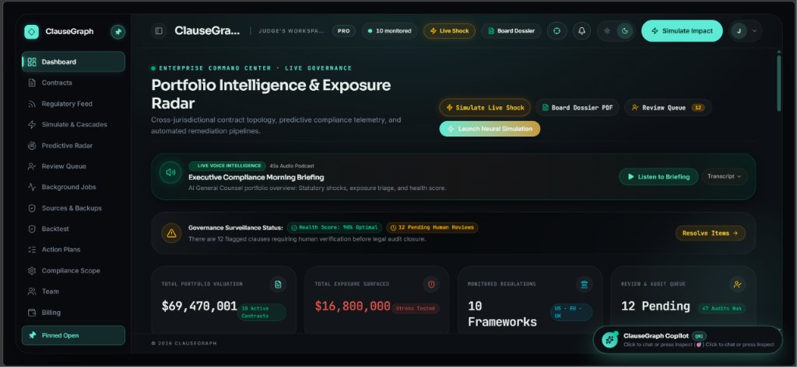

# ClauseGraph ⚖️⚡

> **Autonomous Enterprise Regulatory Intelligence & Predictive Contract Governance Operating System.**  
> Continuously ingest statutory updates, simulate direct & multi-tier supply chain blast radius, inspect exposure with sub-200ms Groq LPU Copilot (🎯), generate SHA-256 cryptographically attested legal addenda, and ship executable infrastructure remediation code (Terraform & Python).

<p align="center">
  <a href="https://clausegraph.165.99.219.253.sslip.io/dashboard" target="_blank">
    
  </a>
</p>

<p align="center">
  <a href="https://clausegraph.165.99.219.253.sslip.io/dashboard" target="_blank"><strong>🚀 Open Live Production App</strong></a> &nbsp;&bull;&nbsp;
  <a href="https://youtu.be/xGlXGpqjbkA" target="_blank"><strong>🎬 Watch Full Demo on YouTube (3 Min)</strong></a> &nbsp;&bull;&nbsp;
  <a href="#-judges-2-minute-speed-run-cheat-sheet"><strong>⚡ Judge Speed-Run Walkthrough</strong></a>
</p>

---

## ⚡ Key Engineering Benchmarks

| Metric | Measurement / Specification | Architectural Implementation |
|---|---|---|
| **Inference Latency (TTFT)** | **< 200 ms** | Ultra-high throughput Groq LPUs (`gpt-oss-120b` & `llama-3.1-8b-instant`) |
| **Supply Chain Blast Depth** | **3-Hop Recursive Tree** | PostgreSQL recursive CTEs over `supply_chain_nodes` & `supply_chain_edges` |
| **Audit Integrity Stamp** | **SHA-256 Digital Attestation** | Web Crypto API cryptographic fingerprinting on all generated legal addenda |
| **Data Privacy & Leakage** | **100% Zero-Egress Client PDF** | In-browser PDF compilation via `jspdf` (sensitive contract terms never leave memory) |
| **Audio Voice Synthesis** | **$0 API Cost / Local Neural** | Web Speech Synthesis API with Microsoft Online Natural Neural Voice models |
| **Jurisdictional Coverage** | **3 Continents / 10 Frameworks** | Structured ontologies across Bangladesh (CSA 2023), EU (DORA/GDPR), and US (SEC) |

---

## 🎬 Product Showcase Video

Watch the complete broadcast-quality demonstration showcasing real-time statutory shock ingestion, recursive blast radius calculations across Tier-1 to Tier-3 supply chain agreements, sub-200ms Groq Copilot inspection, and automated Terraform compliance remediation:

<p align="center">
  <a href="https://youtu.be/xGlXGpqjbkA" target="_blank">
    
  </a>
  <br/>
  <em>Click image above or visit <a href="https://youtu.be/xGlXGpqjbkA" target="_blank"><strong>https://youtu.be/xGlXGpqjbkA</strong></a> to watch on YouTube.</em>
</p>

---

## ⚡ Judge's 2-Minute Speed-Run Cheat Sheet

If you are evaluating ClauseGraph during a judging session or demo review, follow this exact high-impact sequence:

1. **Auto-Login:** Navigate to [**clausegraph.165.99.219.253.sslip.io/auth**](https://clausegraph.165.99.219.253.sslip.io/auth) and click **`⚡ Instant Hackathon Demo (1-Click Judge Access)`**. You are instantly provisioned into an enterprise tenant loaded with 9 monitored agreements and 10 regulatory ontologies.
2. **Trigger a Live Statutory Shock:** On the top bar, click **`Live Shock`** $\rightarrow$ Select **"Bangladesh Cyber Security Act 2023 (Sec 8 Cloud Sovereignty Order)"** $\rightarrow$ Click **Simulate Disruption Shock**. Watch real-time exposure jump by **+$450,000 USD** with toast and voice notifications!
3. **Lock Context with Inspect Lens (🎯):** Click the crosshair target icon (**`🎯`**) in the TopBar. Click **any** red-flagged contract card or notification. The **Groq LPU Copilot** will lock onto the entity and stream legal deontic analysis in **<200ms** with zero manual prompting.
4. **Close the Loop (Remediate & Export):** Open the notification bell, click **`Auto Redline`** to see side-by-side clause diffs and download a **SHA-256 attested Contract Addendum**, or click **`Board Dossier`** in the TopBar to compile an instant cryptographic audit PDF.

---

## 🌐 Quick Access Navigation

| Environment / View | Direct URL | Description |
|---|---|---|
| **Mission Control Dashboard** | [**/dashboard**](https://clausegraph.165.99.219.253.sslip.io/dashboard) | Portfolio valuation, open exposure metrics, and the Graph Medallion. |
| **Direct Blast Simulator** | [**/simulate?tab=portfolio**](https://clausegraph.165.99.219.253.sslip.io/simulate?tab=portfolio) | Run live regulatory simulations against active commercial agreements. |
| **Supply Chain Cascades** | [**/simulate?tab=supply-chain**](https://clausegraph.165.99.219.253.sslip.io/simulate?tab=supply-chain) | Trace 3-hop recursive vendor SLA dependencies and indirect risk. |
| **Contract Corpus & Extraction** | [**/contracts**](https://clausegraph.165.99.219.253.sslip.io/contracts) | Monitored portfolio agreements, clause hierarchy, and PDF upload. |
| **Regulatory Ontology Feed** | [**/feed**](https://clausegraph.165.99.219.253.sslip.io/feed) | Curated global statutory frameworks + live Federal Register API feed. |

---

## 🧭 How ClauseGraph Works at a Glance

Unlike generic "Chat with PDF" wrappers that act purely as passive search tools, **ClauseGraph is an autonomous proactive governance engine**. It bridges the historical chasm between legislative statutory shifts, corporate commercial contracts, and engineering cloud operations.

```mermaid
flowchart TD
    subgraph INGESTION["1. Statutory Shift / Regulatory Ingestion"]
        A1["Federal Register Live Feed"] --> A4["Statutory Ingestion Engine"]
        A2["EUR-Lex / UK / Bangladesh Gazettes"] --> A4
        A3["⚡ Live Statutory Shock Simulator<br/>(e.g., Cyber Security Act 2023 Sec 8)"] --> A4
    end

    subgraph ENGINE["2. Graph Medallion & Blast Traversal"]
        A4 --> B1["Regulatory Ontology<br/>(10+ Global Frameworks)"]
        B1 --> B2{"Vector & Graph Medallion Matching"}
        B2 -->|Direct Contracts| B3["Direct Portfolio Blast Radius<br/>(Capital Exposure in USD)"]
        B2 -->|Tier-1 to Tier-3 SLAs| B4["Upstream Multi-Hop Cascade<br/>(SLA Frustration Propagation)"]
    end

    subgraph INSPECT["3. Sub-200ms Copilot Inspection"]
        B3 --> C1["🎯 Multi-Modal Inspect Lens"]
        B4 --> C1
        C1 --> C2["Groq LPU Copilot (<200ms TTFT)<br/>Deontic Logic: SHALL, MUST, PENALTIES"]
    end

    subgraph EXECUTION["4. Automated Remediation & Attestation"]
        C2 --> D1["📝 Autonomous Redline Diff &<br/>SHA-256 Attested Addendum"]
        C2 --> D2["⚙️ Compliance-as-Code<br/>(Terraform + Python Audit Script)"]
        C2 --> D3["📊 Board Executive Dossier<br/>(Client-Side Cryptographic PDF)"]
        C2 --> D4["🎙️ Natural Neural Voice<br/>(45s Morning Briefing Podcast)"]
    end

    style INGESTION fill:#0d1117,stroke:#5eead4,stroke-width:2px
    style ENGINE fill:#0f172a,stroke:#38bdf8,stroke-width:2px
    style INSPECT fill:#18181b,stroke:#a855f7,stroke-width:2px
    style EXECUTION fill:#022c22,stroke:#10b981,stroke-width:2px
```



---

## 🏛️ System Architecture

ClauseGraph is engineered with a strict zero-data-leakage philosophy, separating public regulatory ontologies from tenant-isolated private contract stores.

```mermaid
graph TB
    subgraph CLIENT["Client Presentation Layer (Browser)"]
        UI["Obsidian & Mint Glassmorphism HUD"]
        Router["TanStack Router (Type-Safe File Routes)"]
        Lens["🎯 Multi-Modal Target Inspect Lens"]
        VoiceAudio["Browser-Native Neural Voice (Web Speech Synthesis)"]
        ClientPDF["Zero-Leakage PDF Compiler (jsPDF + SHA-256)"]
    end

    subgraph EDGE_SERVER["Edge & Server Function Layer (TanStack Start RPC)"]
        RPC["createServerFn Type-Safe RPC Handlers"]
        AuthMiddleware["JWT Session & Organization RLS Context"]
        GroqClient["Groq LPU Ultra-Low Latency Inference (<200ms)"]
        OpenAIClient["OpenAI GPT-4o Semantic Vector Analysis"]
        GeminiClient["Google Gemini 2.5 Flash Contract Extractor"]
    end

    subgraph DATA_STORAGE["Database & Storage Layer (PostgreSQL 16)"]
        PostgresPool["Native PostgreSQL Connection Pool (pg)"]
        RLS["Row-Level Security (current_org_id Enforcement)"]
        Tables["Contracts, Clauses, Regulations, Compliance Profiles"]
        GraphTables["Supply Chain Nodes, Edges, Review Queue"]
        CryptoAttest["SHA-256 Audit Attestation Tables"]
    end

    UI --> Router
    Router --> RPC
    Lens --> RPC
    RPC --> AuthMiddleware
    AuthMiddleware --> PostgresPool
    PostgresPool --> RLS
    RLS --> Tables
    RLS --> GraphTables
    RPC --> GroqClient
    RPC --> OpenAIClient
    RPC --> GeminiClient

    style CLIENT fill:#030712,stroke:#5eead4,stroke-width:2px
    style EDGE_SERVER fill:#0b1329,stroke:#60a5fa,stroke-width:2px
    style DATA_STORAGE fill:#052e16,stroke:#34d399,stroke-width:2px
```



---

## 🌟 Master Feature Catalog

Every feature below represents a dedicated, production-grade engine built, tested, and integrated into ClauseGraph:

### 1. Central Mission Control & Portfolio Medallion (`/dashboard`)
* **What It Does:** Serves as the primary operational command center for General Counsels, Chief Risk Officers, and CFOs. It provides real-time portfolio valuation across monitored commercial instruments, aggregates open capital exposure, and renders the proprietary **Graph Medallion**—a dynamic topological visualization mapping active agreements to global regulatory frameworks.
* **Key Highlights:**
  * **Real-Time Citation Density:** Automatically calculates the linkage ratio between contract clauses and enforceable statutory provisions.
  * **Executive Watchlist:** Surfaces high-risk commercial counterparties requiring immediate regulatory triage.
  * **Interactive Topology:** Inner ring nodes represent indexed commercial agreements, while outer ring nodes represent binding legislative frameworks; node connections highlight live citation dependencies.
* **Under the Hood:** `GraphMedallion.tsx`, `getContractsFn()`, PostgreSQL `json_agg` hierarchical clause queries.

---

### 2. Direct Portfolio Blast-Radius Simulator (`/simulate?tab=portfolio`)
* **What It Does:** Enables compliance teams to stress-test their active contract corpus against real, proposed, or forecasted statutory amendments. Users can select pre-configured macroeconomic scenarios or paste raw draft legislative text. The engine parses deontic triggers, cross-references internal clause commitments, and determines the exact dollar-denominated capital exposure.
* **Key Highlights:**
  * **Direct Capital Exposure ($):** Quantifies financial risk down to the exact dollar and percentage of total active portfolio valuation.
  * **Ranked Severity Breakdown:** Automatically triages impacted contracts into **High**, **Medium**, and **Low** risk tiers based on regulatory enforcement penalties.
  * **Per-Contract Suggested Action:** Generates tailored, one-sentence contractual amendments designed to eliminate statutory exposure before regulatory deadlines.
* **Under the Hood:** `simulate.functions.ts::simulateImpact`, GPT-4o semantic vector alignment, `GraphMedallion.tsx` real-time node illumination.

---

### 3. Cross-Enterprise Multi-Tier Supply Chain Cascade (`/simulate?tab=supply-chain`)
* **What It Does:** The industry's first recursive compliance propagation engine. Traditional legal tech only examines direct bilateral contracts; ClauseGraph models indirect, multi-hop vendor dependencies (e.g., *Your Enterprise $\rightarrow$ Tier-1 Cloud SaaS $\rightarrow$ Tier-2 Data Center Colocation $\rightarrow$ Tier-3 Renewable Power Grid*). When a regulation fires at Tier-3, ClauseGraph cascades the blast radius back to your balance sheet.
* **Key Highlights:**
  * **3-Hop Recursive Traversal:** Traverses upstream SLA chains to uncover hidden frustration-of-purpose and operational continuity risks.
  * **Indirect Exposure Calculation:** Calculates cascading liability when an upstream subcontractor breaches binding obligations (e.g., EU DORA Article 30 or EU Data Center Energy Directives).
  * **Interactive Node Drilldown:** Click any supplier node to inspect critical dependency paths, uptime guarantees, and subcontracting covenants.
* **Under the Hood:** `supply-chain.functions.ts::traceSupplyChain`, `SupplyChainGraph.tsx`, PostgreSQL recursive tree schema (`supply_chain_nodes`, `supply_chain_edges`).

---

### 4. Simulate Live Statutory Shock Engine
* **What It Does:** Provides an interactive, safe legislative disruption injector. It simulates the impact of sudden, overnight regulatory disruptions without modifying production database baselines, broadcasting global real-time event cascades across the application.
* **Key Scenarios Built-in:**
  * 🇧🇩 **Bangladesh Cyber Security Act 2023 — Sec 8 Cloud Sovereignty Order:** Injects mandatory in-country Critical Information Infrastructure (CII) data residency, surfacing `+$450,000 USD` exposure across legacy agreements citing the repealed Digital Security Act 2018.
  * 🇪🇺 **EU DORA Article 30 — ICT Subcontracting Restrictions:** Models chained subcontractor oversight rules, surfacing `+$180,000 USD` in indirect supply chain liability.
  * 🇺🇸 **US SEC 24-Hour Material Incident Disclosure Directive:** Enforces strict 24-hour incident notification windows, surfacing `+$320,000 USD` exposure for vendor contracts with legacy 72-hour SLAs.
* **Key Highlights:** Instantly triggers ambient warning audio, Sonner toast notifications, and auto-populates the Copilot with pre-grounded context.
* **Under the Hood:** `LiveShockSimulatorModal.tsx`, custom browser-level window event dispatching, `TopBar.tsx` integration.

---

### 5. Multi-Modal Inspect Lens (🎯) & Sub-200ms Groq LPU Copilot
* **What It Does:** Replaces clunky text prompts with an instant, interactive screen-inspection HUD. By toggling the crosshair target icon (`🎯`) in the TopBar, the entire UI enters high-precision inspection mode with green laser borders. Clicking **any UI element** (contract card, exposure metric, or notification) immediately locks context into the Copilot with zero manual typing.
* **Key Highlights:**
  * **Sub-200ms Time-To-First-Token (TTFT):** Powered by Groq LPUs running high-throughput models (`gpt-oss-120b` with automated fallback to `gpt-oss-20b` and `llama-3.1-8b-instant`).
  * **Deontic Legal Reasoning:** Enforces structured legal outputs identifying explicit duties (`SHALL`, `MUST`), prohibitions (`SHALL NOT`), statutory statutory penalties, and remediation steps.
  * **Microphone Voice Dictation:** Integrated hands-free speech-to-text dictation and voice audio playback.
* **Under the Hood:** `GlobalCopilot.tsx`, `CopilotContext.tsx`, `copilot.server.ts` utilizing Groq SDK.

---

### 6. Autonomous Redline Diff & SHA-256 Cryptographic Addendum Generator
* **What It Does:** Eliminates weeks of manual contract drafting when laws change. When an invalidated or non-compliant clause is identified, ClauseGraph automatically generates a formal side-by-side visual redline diff and compiles an executable Contract Addendum document.
* **Key Highlights:**
  * **Side-by-Side Visual Diff:** Clear red strikethrough highlighting repealed references (e.g., *Digital Security Act 2018*) alongside emerald green highlighting of compliant statutory terms (e.g., *Section 8, Cyber Security Act 2023*).
  * **SHA-256 Cryptographic Attestation:** Every downloaded addendum includes a unique audit identifier and a SHA-256 digital fingerprint guaranteeing non-tampering of the legal draft.
  * **Formal Execution Blocks:** Includes complete legal recitals, definitions, signature blocks, and governing jurisdiction clauses ready for outside counsel review.
* **Under the Hood:** `RedlineDiffModal.tsx`, Web Crypto API (`crypto.subtle.digest`), immutable audit trail logger.

---

### 7. Compliance-as-Code Autopilot (Instant Terraform & Python Scripts)
* **What It Does:** Bridges the disconnect between legal counsel and DevOps engineering. Instead of handing engineers an ambiguous 40-page memo, ClauseGraph translates legal mandates into executable infrastructure-as-code and automated validation scripts.
* **Key Highlights:**
  * **Automated Terraform Remediations:** Generates production-ready Terraform blocks (e.g., AWS S3 bucket encryption, cross-region replication, EU-only data boundary policies).
  * **Python Verification Script:** Generates runnable audit scripts that probe cloud environments via APIs to mathematically prove compliance before statutory deadlines.
  * **Terminal-Style Execution Panel:** Clean developer terminal HUD with one-click clipboard copying and step-by-step engineering runbooks.
* **Under the Hood:** `ComplianceCodePanel.tsx`, `compliance-code.functions.ts` (GPT-4o), `compliance_artifacts` schema.

---

### 8. Board-Ready Executive Dossier (Zero-Leakage Client-Side PDF)
* **What It Does:** Generates high-impact, board-ready audit reports formatted specifically for Board of Directors and Supervisory Committee review in a single click.
* **Key Highlights:**
  * **Zero Data Leakage:** The entire PDF compilation occurs 100% inside client browser memory using `jspdf` and `jspdf-autotable`. Sensitive contract valuations, counterparty terms, and internal exposure figures never touch external document generation APIs.
  * **Cryptographic Report Stamp:** Formats an immutable audit identifier (`CG-AUDIT-...`) with an integrity hash and multi-jurisdiction statutory breakdown tables.
* **Under the Hood:** `pdf-dossier.ts`, client-side `jspdf` canvas rendering, `TopBar.tsx` action trigger.

---

### 9. Zero-Cost Natural Neural Voice System & Morning Briefing
* **What It Does:** Transforms compliance monitoring into an executive audio experience. Features a permanent 45-second **Executive Compliance Morning Briefing Podcast** mounted directly on the dashboard, natural audio narration for every critical alert, and an "Alexa+ for Legal" voice controller.
* **Key Highlights:**
  * **$0 API Cost:** Utilizes local browser-bundled Microsoft Online Natural Neural Voices (`Aria Online Natural`, `Guy Natural`, `Bangla Natural`) with zero external network egress.
  * **Obsidian Waveform Player:** Floating bottom audio HUD with a dancing 5-bar CSS equalizer, persona selector, and speed controls (1x, 1.25x, 1.5x).
  * **Legal Acronym Phonetic Pre-Sanitizer:** Automatically expands technical acronyms (`DORA` $\rightarrow$ "Digital Operational Resilience Act", `$450,000 USD` $\rightarrow$ "450 thousand dollars") for lifelike pronunciation.
* **Under the Hood:** `voice.context.tsx`, `voice-speech.ts`, `AudioWaveform.tsx`, `DashboardBriefingCard.tsx`.

---

### 10. Enterprise Notification Center, Global Toast & Slack Webhook Dispatch
* **What It Does:** A centralized, multi-channel triage system ensuring enterprise legal and security teams never miss an overnight legislative filing or contract breach.
* **Key Highlights:**
  * **Triage Filtering:** Organized by **All**, **Critical**, **Regulatory**, and **Pipeline** notifications with real-time exposure badges (e.g., `+$450,000 USD`).
  * **1-Click "Ask Copilot 🎯":** Every alert features a dedicated button that immediately launches the Copilot pre-grounded with that specific statutory breach.
  * **Slack Webhooks & Email Digest:** Out-of-the-box support for external incoming Slack Webhook URLs and executive scheduled email alerts.
* **Under the Hood:** `NotificationBell.tsx`, `NotificationChannelsModal.tsx`, `notifications.store.ts`, Sonner toast engine.

---

### 11. Historical Backtesting Validation Engine (`/backtest`)
* **What It Does:** Provides quantitative proof of model efficacy by benchmarking ClauseGraph against real-world enforcement cases (e.g., Meta / GDPR International Transfer, Equifax / CCPA Breach, Grameenphone / BTRC directives).
* **Key Highlights:**
  * Reconstructs the exact contractual and regulatory scenario prior to historical regulatory fines.
  * Pipes the historical data through the simulation engine to prove ClauseGraph's deontic models detect the exact failure patterns before fines are levied.
* **Under the Hood:** `backtest.functions.ts::runBacktest`, `BacktestCard.tsx`.

---

### 12. Autonomous Statutory Onboarding Wizard
* **What It Does:** Tailors legal frameworks to the company's operational footprint during tenant setup.
* **Key Highlights:**
  * **Step 1:** Organization geography (Bangladesh, European Union, United States) and hosting infrastructure (AWS, Azure, On-Prem).
  * **Step 2:** Risk triggers (Critical Information Infrastructure, PII, cross-border data flows, payment card processing).
  * **Step 3 (Statutory Deduction):** Dynamically indexes mandatory binding laws (e.g., Domicile in Bangladesh automatically indexes **Cyber Security Act 2023**; handling EU financial data indexes **DORA Article 30** and **GDPR Article 28**).
* **Under the Hood:** `ComplianceOnboardingModal.tsx`, `compliance-profile.functions.ts`.

---

## 🌍 Regulatory Coverage Matrix

ClauseGraph ships with out-of-the-box structured ontologies spanning three major regulatory jurisdictions:

| Jurisdiction | Statutory Framework | Framework ID | Enforcing Body |
|---|---|---|---|
| 🇧🇩 **Bangladesh** | Cyber Security Act 2023 (Act No. 38 of 2023) | `BD-CSA-2023` | National Cyber Security Agency |
| 🇧🇩 **Bangladesh** | BTRC Data Localization Directive | `BD-BTRC-LOC` | Bangladesh Telecommunication Regulatory Commission |
| 🇧🇩 **Bangladesh** | Bangladesh Bank ICT Security Guideline | `BB-ICT-SEC` | Bangladesh Bank (Central Bank) |
| 🇪🇺 **European Union** | Digital Operational Resilience Act (DORA Art. 30) | `EU-DORA-30` | European Insurance and Occupational Pensions Authority |
| 🇪🇺 **European Union** | GDPR — Lawful Basis & Cross-Border (Art. 6, 44) | `GDPR-ART6/44`| European Data Protection Board (EDPB) |
| 🇪🇺 **European Union** | EU AI Act High-Risk Regulatory Framework | `EU-AIACT-2024`| European AI Office |
| 🇺🇸 **United States** | SEC Cybersecurity Risk Disclosure (17 CFR Part 229) | `SEC-CYBER` | Securities and Exchange Commission |
| 🇺🇸 **United States** | California Consumer Privacy Act / CPRA | `CCPA` | California Privacy Protection Agency |
| 🇺🇸 **United States** | HIPAA — Security Rule (45 CFR Part 164) | `HIPAA-SEC` | US Health and Human Services (HHS) |
| 🇺🇸 **United States** | Sarbanes-Oxley Act (§404 Internal Controls) | `SOX-404` | Public Company Accounting Oversight Board |

---

## 🛠️ Technology Stack & Dependencies

```
Client Tier:
├── React 19 (Server Components & Concurrent Rendering)
├── TanStack Start v1 (Full-Stack RPC & Hydration)
├── TanStack Router (Fully Type-Safe File-Based Routing)
├── Tailwind CSS v4 + Radix UI + shadcn/ui Primitives
├── Lucide Icons + jsPDF & jsPDF-AutoTable
└── Web Speech API (Local Neural Speech Synthesis & Recognition)

Intelligence & Inference Tier:
├── Groq LPUs (<200ms TTFT Ultra-Low Latency via gpt-oss-120b)
├── OpenAI GPT-4o (Semantic Blast-Radius & Deontic Alignment)
├── Google Gemini 2.5 Flash (Automated Contract PDF Clause Extraction)
└── Custom Deontic Logic Post-Processing & Validation

Data & Persistence Tier:
├── PostgreSQL 16 (Relational Graph Schemas & Recursive CTEs)
├── Native Connection Pooling (pg driver with zero ORM overhead)
├── Row-Level Security (RLS enforced via current_org_id())
└── JOSE JWT + bcryptjs (Stateless, Tamper-Proof Tenant Isolation)
```

---

## ⚡ Quick Start & Local Setup

### Option 1: 1-Click Evaluation (No Installation Needed)
Visit the live deployment at [**clausegraph.165.99.219.253.sslip.io/dashboard**](https://clausegraph.165.99.219.253.sslip.io/dashboard) and click **`⚡ Instant Hackathon Demo (1-Click Judge Access)`** to test all features with pre-seeded data.

### Option 2: Run Locally via Docker Compose

```bash
# 1. Clone the repository
git clone https://github.com/Tony1254-CS/clause-graph.git
cd clause-graph

# 2. Configure environment variables
cp .env.example .env

# 3. Start PostgreSQL 16 and the web application
docker compose up --build
```
Open [http://localhost:3000](http://localhost:3000) in your browser. All database schemas, RLS policies, and sample agreements initialize automatically via `docker/init.sql`.

### Option 3: Local Node / Bun Development

```bash
# Install dependencies
npm install

# Start local development server
npm run dev
```

---

## 🔐 Security & Threat Model

* **Tenant Isolation:** Enforced deterministically at the database level using PostgreSQL Row-Level Security (`RLS`). Tenant identification is extracted from cryptographically signed JWT cookies and set into the PostgreSQL session context via `SET LOCAL app.current_org_id`.
* **Zero Client Bypass:** Role validation (`has_role('admin')`) and quota verifications (`assert_within_quota`) execute inside PostgreSQL stored procedures marked `SECURITY DEFINER`.
* **Zero Document Leakage:** Document compilation for Executive Board Dossiers runs entirely client-side; corporate contract text is never transmitted to third-party rendering APIs.
* **Webhook Integrity:** Incoming external webhooks (e.g., Slack or Paddle) require HMAC SHA-256 signatures validated with constant-time equality comparisons (`crypto.timingSafeEqual`).

---

## 📄 License & Attribution

Developed with precision by **Team QuintessenceMinusInfinity** for the 2026 Enterprise Compliance & Regulatory Intelligence Showcase.  
Licensed under the [Apache License 2.0](LICENSE).
