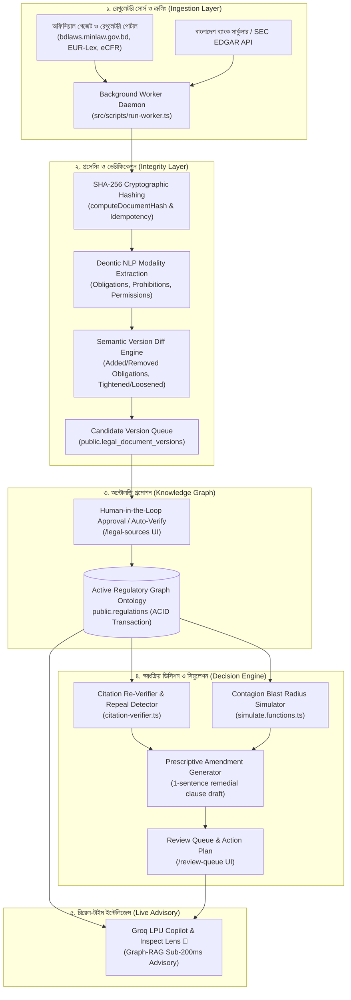

# ClauseGraph: Autonomous Statutory Ingestion & Decision-Making Engine

> **Core Value Proposition**: সাধারণ Legal-Tech সফটওয়্যার কেবল স্থির (Static) ডকুমেন্ট সার্চ করতে পারে। কিন্তু **ClauseGraph** একটি লিভিং রেগুলেটরি নলেজ গ্রাফ (Living Regulatory Knowledge Graph)। রাতের বেলা বিশ্বের যেকোনো প্রান্তে (যেমন: বাংলাদেশ, ইউরোপ বা আমেরিকা) কোনো নতুন আইন বা সংশোধনী গেজেট আকারে প্রকাশিত হলে আমাদের সিস্টেম তা ক্রিপ্টোগ্রাফিক ভেরিফিকেশনের মাধ্যমে অন্টোলজিতে সিঙ্ক করে, পুরো কন্ট্রাক্ট পোর্টফোলিওতে ক্যাসকেডিং ব্লাস্ট রেডিয়াস ম্যাপ করে, এবং সকালে লিগ্যাল টিমের টেবিলে রেডিমেড সংশোধনী ড্রাফট ও ডিসিশন উপস্থাপন করে।

---

## ১. এন্ড-টু-এন্ড সিস্টেম আর্কিটেকচার (End-to-End Pipeline)

---

## ২. পর্ব ১: নতুন আইন কীভাবে Auto-Update হয়? (The Ingestion Pipeline)

ধরা যাক, আজ রাতে বাংলাদেশে নতুন একটি আইন (যেমন: Cyber Security Act-এর কোনো নতুন ধারা বা Bangladesh Bank Circular) অথবা ইউরোপে EU AI Act-এর কোনো নতুন টেকনিক্যাল স্ট্যান্ডার্ড গেজেট আকারে প্রকাশিত হলো। সিস্টেম যেভাবে স্বয়ংক্রিয়ভাবে এটি আপডেট করে:

### ১. অথরিটেটিভ সোর্স কানেক্টর ও ব্যাকগ্রাউন্ড ওয়ার্কার
- **কোড ফাইল**: `src/scripts/run-worker.ts` এবং `src/lib/jobs.worker.ts`
- সিস্টেম ব্যাকগ্রাউন্ডে একটি সার্বক্ষণিক ডেমন চালায় যা নির্দিষ্ট সময় পর পর রেজিস্টার্ড সরকারি এন্ডপয়েন্ট ও লিগ্যাল গেজেটে নতুন রিলিজ পরীক্ষা করে।
- **সমর্থিত জুরাসডিকশন ও সোর্স রেজিস্ট্রি** (`src/lib/citation-corpus.ts` & `src/lib/document-update.server.ts`):
  - **বাংলাদেশ (BD)**: Ministry of Law Gazette (`bdlaws.minlaw.gov.bd`), Bangladesh Bank BRPD/DPS Circulars।
  - **ইউরোপীয় ইউনিয়ন (EU)**: EUR-Lex Official Journal (OJ) API।
  - **যুক্তরাষ্ট্র (US)**: Federal Register, eCFR, SEC EDGAR API।

### ২. ক্রিপ্টোগ্রাফিক হ্যাশিং ও আইডেমপোটেন্সি (Zero-Duplication Engine)
- **কোড ফাইল**: `src/lib/document-update.server.ts` (`computeDocumentHash()`)
- যখনই কোনো নতুন টেক্সট বা ডকুমেন্ট আসে, সিস্টেম কাঁচা টেক্সট এবং তার এক্সট্রাক্টেড বাধ্যবাধকতার উপর একটি **SHA-256 ক্রিপ্টোগ্রাফিক হ্যাশ** তৈরি করে।
- **Idempotency Safeguard**: যদি একই ডকুমেন্ট বারবার আসে, সিস্টেম ডাটাবেজে কোনো ডুপ্লিকেট তৈরি করে না। আগের হ্যাশের সাথে মিলে গেলে প্রসেসিং সেখানেই নিরাপদে স্কিপ হয়।

### ৩. ফল্ট-টলারেন্ট কানেক্টর (Safe Failure Handling)
- কোনো সরকারি সার্ভারে যদি সাময়িক নেটওয়ার্ক ডাউন থাকে (HTTP 503) অথবা রেট-লিমিট (HTTP 429) আসে:
- সিস্টেম সোর্সটিকে `OFFLINE` বা `RATE_LIMITED` হিসেবে ফ্ল্যাগ করে এক্সপোনেনশিয়াল ব্যাকঅফ গ্রহণ করে।
- **গোল্ডেন রুল**: নেটওয়ার্ক এরর বা আউটেজের কারণে ডাটাবেজে থাকা কোনো বিদ্যমান সক্রিয় আইন কখনোই মুছে (Delete) বা বাতিল (Repeal) হয় না।

### ৪. ডিওনটিক এনএলপি এক্সট্রাকশন (Deontic Modalities & Version Diff)
- **কোড ফাইল**: `src/lib/document-update.server.ts` (`computeVersionDiff()`)
- লিগ্যাল টেক্সটকে জেনেরিক সামারি করার পরিবর্তে সিস্টেম ৩টি আন্তর্জাতিক লিগ্যাল স্ট্যান্ডার্ড ডিওনটিক ফর্মে আলাদা করে:
  - **Obligations (বাধ্যবাধকতা)**: কোম্পানিকে কী অবশ্যই করতে হবে (Shall / Must)।
  - **Prohibitions (নিষেধাজ্ঞা)**: কোম্পানি কী করতে পারবে না (Shall not / Must not)।
  - **Permissions (অনুমতি)**: কোম্পানি কী করতে পারে (May)।
- পূর্ববর্তী সংস্করণের সাথে তুলনা করে একটি নিখুঁত **Version Diff** তৈরি হয়:
  - `addedObligations`: নতুন কোন কোন বাধ্যবাধকতা যোগ হলো।
  - `removedObligations`: কোন নিয়ম শিথিল করা হলো।
  - `amendmentDirection`: আইনটি কি কঠোর হলো (`tightened`), বিস্তৃত হলো (`expanded`), নাকি স্পষ্ট করা হলো (`clarified`)।

### ৫. অডিট-যোগ্য ক্যান্ডিডেট কিউ এবং ACID অন্টোলজি প্রমোশন
- **কোড ফাইল**: `src/lib/document-update.server.ts` (`approveDocumentVersion()`)
- আইন পেশাজীবী ও এন্টারপ্রাইজ কমপ্লায়েন্স টিমের জন্য অডিটেবিলিটি অত্যন্ত গুরুত্বপূর্ণ। কোনো AI গোপনে সক্রিয় আইন পরিবর্তন করতে পারে না।
- নতুন সংস্করণটি প্রথমে `DISCOVERED` স্ট্যাটাসে `/legal-sources` পেইজের ক্যান্ডিডেট কিউতে জমা থাকে।
- অনুমোদনের সাথে সাথে ডাটাবেজে একটি **PostgreSQL ACID Transaction** রান করে:
  1. পূর্ববর্তী সক্রিয় আইনকে `SUPERSEDED` স্ট্যাটাস দেয়া হয়।
  2. বর্তমান আইনকে `VERIFIED` হিসেবে প্রমোট করা হয়।
  3. মূল নলেজ গ্রাফ টেবিল `public.regulations`-এ স্বয়ংক্রিয়ভাবে টাইটেল, সামারি এবং নতুন অবলিগেশন আপডেট হয়।
  4. ঐতিহাসিক ট্র্যাকিংয়ের জন্য `public.regulation_amendments`-এ অ্যামেন্ডমেন্টের ইতিহাস রেকর্ড করা হয়।

---

## ৩. পর্ব ২: নতুন আইনের ওপর ভিত্তি করে Decision কীভাবে হয়? (The Decision Engine)

আইন আপডেট হওয়ার পর সিস্টেম চুপচাপ বসে থাকে না। সম্পূর্ণ স্বয়ংক্রিয়ভাবে পুরো কন্ট্রাক্ট পোর্টফোলিওর ওপর ৫-স্তরের ডিসিশন মেকিং প্রসেস শুরু হয়:

### ১. ডিরেক্টেড নলেজ গ্রাফ ট্রাভার্সাল (Graph Traversal)
- প্রতিটি আপলোডকৃত চুক্তির ক্লজসমূহ ডাটাবেজে কোনো ফ্ল্যাট টেক্সট নয়; সেগুলো গ্রাফ রিলেশনের মাধ্যমে যুক্ত থাকে:
  $$\text{Contract} \longrightarrow \text{Clauses} \stackrel{\text{linked\_regs}}{\longleftrightarrow} \text{Regulations}$$
- নতুন আইন আসার সাথে সাথে গ্রাফ ট্রাভার্সাল শুরু হয়: **"আমার ডাটাবেজের কোন কোন চুক্তিতে এই নির্দিষ্ট রেগুলেশনের লিঙ্ক বা প্রাসঙ্গিক শব্দ রয়েছে?"**

### ২. সাইটেশন ভেরিফিকেশন ও বাতিল আইন সনাক্তকরণ (Repeal Detection)
- **কোড ফাইল**: `src/lib/citation-verifier.ts`
- ব্যাকগ্রাউন্ড ওয়ার্কারের মাধ্যমে `CITATION_REVERIFY` শিডিউল্ড জব কার্যকর হয়।
- এটি প্রতিটি চুক্তির ক্লজে থাকা রেফারেন্সের সাথে লাইভ করপাস যাচাই করে:
  - **বাস্তব উদাহরণ**: আপনার কোনো ভেন্ডর চুক্তিতে যদি লেখা থাকে: *"Compliance with Digital Security Act 2018"*।
  - সিস্টেম স্বয়ংক্রিয়ভাবে ফ্ল্যাগ তুলবে: 
    - **Status**: `REPEALED` (বাতিলকৃত)
    - **Risk Level**: `HIGH`
    - **Superseded By**: *"Cyber Security Act 2023 (Act No. 40 of 2023)"*
  - একইভাবে ইইউ চুক্তিতে বাতিল Directive 95/46/EC থাকলে GDPR-এ এবং বাতিল Privacy Shield থাকলে নতুন DPF-এ প্রতিস্থাপনের নির্দেশ জারি করে।

### ৩. কনট্যাজিয়ন সিমুলেশন ও ব্লাস্ট রেডিয়াস ক্যালকুলেশন (Contagion & Blast Radius)
- **কোড ফাইল**: `src/lib/simulate.functions.ts`
- নতুন বা সংশোধিত আইনটি নিয়ে সিমুলেশন ইঞ্জিন পুরো পোর্টফোলিওর ওপর স্ট্রেস টেস্ট রান করে:
  - **আক্রান্ত চুক্তির তালিকা**: কোন কোন ক্লায়েন্ট বা ভেন্ডর চুক্তি সরাসরি নতুন আইনের পরিপন্থী।
  - **Severity স্কোরিং**: ঝুঁকির তীব্রতা কি `HIGH`, `MEDIUM`, নাকি `LOW`।
  - **ফাইন্যান্সিয়াল এক্সপোজার (Blast Radius)**: চুক্তির আর্থিক মূল্য (`contract.value`) যোগ করে মোট কত ডলার/টাকার পোর্টফোলিও ঝুঁকির মুখে আছে তা মুহূর্তের মধ্যে প্রদর্শন করে।

### ৪. প্রেসক্রিপটিভ সংশোধন ড্রাফটিং (AI Auto-Remediation)
- সিস্টেম শুধু সমস্যা দেখিয়ে ক্ষান্ত হয় না, সাথে সাথে সমাধান প্রস্তুত করে:
  - প্রতিটি আক্রান্ত চুক্তির জন্য ঠিক **১টি নির্দিষ্ট সংশোধন বাক্য (Suggested Amendment)** তৈরি করে।
  - যেমন: *"Update Clause 14.1: Replace DSA 2018 reference with Section 26 of CSA 2023 and update incident reporting window from 72 hours to 24 hours."*
- এই ডিসিশন ও সংশোধনীগুলো সরাসরি চলে যায় **Review Queue** (`/review-queue`)-তে, যেখানে লিগ্যাল টিম এক ক্লিকে তা 'Accept' বা 'Batch Export' করতে পারে।

### ৫. Groq LPU Copilot & Inspect Lens তাৎক্ষণিক রেসপন্স
- **কোড ফাইল**: `src/lib/copilot.server.ts`
- আমাদের কপাইলটে **Graph-RAG** সংযুক্ত থাকায়, আইন অন্টোলজিতে প্রমোট হওয়ার সাথে সাথে গ্লোবাল কপাইলট এবং **🎯 Inspect Lens** নতুন নিয়মের ব্যাপারে সম্পূর্ণ সচেতন হয়ে যায়।
- ব্যবহারকারী ড্যাশবোর্ড বা সিমুলেটরের যেকোনো কার্ডে ক্লিক করলে নতুন আইনের সাপেক্ষে চেইন-অব-থট (CoT) লজিক সহ সাব-সেকেন্ডে পরামর্শ দিতে পারে।

---

## ৪. বাস্তব উদাহরণ: একটি নতুন সাইবার নিরাপত্তা আইন জারির পূর্ণ চিত্র

| ধাপ | সময় | সিস্টেমে যা ঘটে | আউটপুট / ফলাফল |
|---|---|---|---|
| **Step 1** | রাত ১২:৩০ | সরকারি গেজেট সাইটে নতুন নোটিফিকেশন প্রকাশিত হয়: *"Critical Information Infrastructure (CII) সংস্থাগুলোকে ১২ ঘণ্টার মধ্যে যেকোনো সিকিউরিটি ব্রিচ রিপোর্ট করতে হবে (পূর্বের ৭২ ঘণ্টার স্থলে)"*। | কাঁচা গেজেট টেক্সট ব্যাকগ্রাউন্ড ওয়ার্কারে ডাউনলোড হয়। |
| **Step 2** | রাত ১২:৩১ | সিস্টেম SHA-256 হ্যাশ বের করে এবং ডিওনটিক এক্সট্রাকশন চালায়। | নতুন অবলিগেশন শনাক্ত: `Incident Notification <= 12 hours`। `amendmentDirection: tightened`। |
| **Step 3** | রাত ১২:৩২ | ক্যান্ডিডেট ভার্সন তৈরি হয় এবং অনুমোদনের পর `public.regulations`-এ স্বয়ংক্রিয়ভাবে প্রমোট হয়। | অন্টোলজি আপডেট সম্পন্ন। |
| **Step 4** | রাত ১২:৩৩ | `CITATION_REVERIFY` জব ট্রিগার হয় এবং পুরো কন্ট্রাক্ট গ্রাফ স্ক্যান করে। | ৪টি বড় ক্লাউড ও ভেন্ডর চুক্তিতে পূর্ববর্তী "৭২ ঘণ্টা" ধারাটি ভায়োলেশন হিসেবে চিহ্নিত হয়। |
| **Step 5** | রাত ১২:৩৪ | সিমুলেটর ব্লাস্ট রেডিয়াস ক্যালকুলেট করে। | **$1,250,000 USD** মূল্যের ৪টি চুক্তিতে হাই-রিস্ক ভায়োলেশন ফ্ল্যাগ পড়ে। |
| **Step 6** | সকাল ৯:০০ | লিগ্যাল টিম অফিস খুলে ড্যাশবোর্ডে ও Review Queue-তে ৪টি রেডিমেড সংশোধনী ড্রাফট দেখতে পায় এবং এক ক্লিকে তা এক্সেপ্ট করে। | সময় সাশ্রয়: কয়েক সপ্তাহ বনাম কয়েক মিনিট! |

---

## ৫. AI কম্পিটিশন পিচিং গাইড (Pitching Matrix)

প্রতিযোগিতায় বিচারকদের সামনে উপস্থাপনের জন্য এই তুলনামূলক চার্টটি অত্যন্ত কার্যকর:

| বৈশিষ্ট্য | সাধারণ Legal-Tech / Generic RAG | ClauseGraph Autonomous Engine |
|---|---|---|
| **আইনের পরিবর্তন ট্র্যাকিং** | ম্যানুয়াল (কেউ নতুন পিডিএফ আপলোড না করলে জানে না) | **স্বয়ংক্রিয় ক্রলিং ও ক্রিপ্টোগ্রাফিক হ্যাশিং** |
| **বাতিল আইন সনাক্তকরণ** | পারে না (পুরোনো আইনকে সত্য মনে করে হ্যালুসিনেট করে) | **অফিসিয়াল সাইটেশন ভেরিফিকেশন ও Repeal ডিটেকশন** |
| **প্রভাব পরিমাপ** | কেবল টেক্সট সামারি দিতে পারে | **ডলার মূল্যে ব্লাস্ট রেডিয়াস ও ক্যাসকেডিং এক্সপোজার হিসাব** |
| **সংশোধন প্রক্রিয়া** | আইনজীবীকেই স্ক্র্যাচ থেকে নতুন ক্লজ লিখতে হয় | **১ বাক্যের প্রেসক্রিপটিভ সংশোধন ড্রাফট অটোমেটিক তৈরি** |
| **বিশ্বাসযোগ্যতা ও সেফটি** | ব্ল্যাক বক্স (আইন পরিবর্তন হলেও লগ থাকে না) | **ACID ট্রানজ্যাকশন ও সম্পূর্ণ অডিট ট্রেইল** |

### 🎙️ জুরিদের জন্য ১-লাইনার পাঞ্চলাইন:
> *"ClauseGraph transforms passive legal documents into a dynamic, real-time nervous system. When the law changes anywhere in the world, our graph reacts instantaneously — calculating your exposure and drafting your amendments before your morning coffee."*
