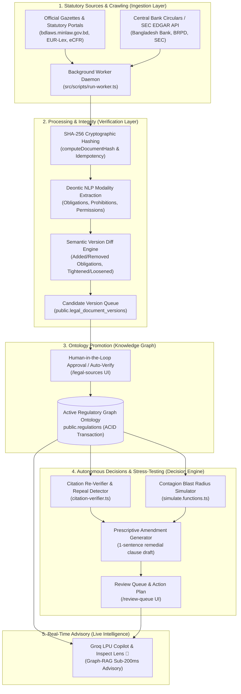

# ClauseGraph: Autonomous Statutory Ingestion & Decision-Making Engine

> **Core Value Proposition**: Conventional legal technology tools only search static, pre-indexed documents. In contrast, **ClauseGraph** functions as a living regulatory knowledge graph. When new statutory amendments, administrative rules, or regulatory gazettes are enacted anywhere in the world (e.g., Bangladesh, the European Union, or the United States), ClauseGraph ingests the source text, cryptographically verifies its integrity, computes semantic deontic diffs, traverses the enterprise contract topology, quantifies cascading financial blast radius exposures, and presents counsel with ready-to-execute remedial amendments before the start of the business day.

---

## 1. End-to-End System Architecture

---

## 2. Phase 1: How Autonomous Statutory Ingestion Operates (The Ingestion Pipeline)

Consider an operational scenario: overnight, a sovereign authority publishes a new statutory gazette (e.g., an amendment to the Cyber Security Act or a new Central Bank Digital Payment Circular), or the European Commission issues updated technical standards under the EU AI Act. The autonomous ingestion engine processes this event through five structured phases:

### 1. Authoritative Source Connectors & Background Worker
- **Source Files**: `src/scripts/run-worker.ts` and `src/lib/jobs.worker.ts`
- The system executes a persistent background daemon that polls designated authoritative endpoints, government gazette portals, and legislative feeds on a scheduled interval.
- **Supported Jurisdictions & Source Registry** (`src/lib/citation-corpus.ts` & `src/lib/document-update.server.ts`):
  - **Bangladesh (BD)**: Ministry of Law Legislative Portal (`bdlaws.minlaw.gov.bd`), Bangladesh Bank BRPD/DPS Circulars.
  - **European Union (EU)**: EUR-Lex Official Journal (OJ) API.
  - **United States (US)**: Federal Register, eCFR, SEC EDGAR API.

### 2. Cryptographic Hashing & Idempotency Safeguards
- **Source File**: `src/lib/document-update.server.ts` (`computeDocumentHash()`)
- Upon receiving incoming raw text or PDF content, the system computes a **SHA-256 cryptographic digest** over the raw text and its extracted deontic structure.
- **Idempotency Safeguard**: If an identical document is polled multiple times, the cryptographic hash matches the existing record in `public.legal_document_versions`, and processing terminates safely without creating redundant database entries.

### 3. Fault-Tolerant Connectors & Safe Failure Handling
- When government portals encounter intermittent downtime (HTTP 503) or impose rate limits (HTTP 429), the connector transitions the source state to `OFFLINE` or `RATE_LIMITED` and applies an exponential backoff strategy.
- **Golden Operational Rule**: Network interruptions or scraping errors never trigger destructive database operations; existing active regulations are never dropped, invalidated, or marked as repealed due to connection timeouts.

### 4. Deontic NLP Extraction & Version Diff Engine
- **Source File**: `src/lib/document-update.server.ts` (`computeVersionDiff()`)
- Rather than generating unstructured summaries, the NLP engine parses statutory text into standardized deontic modalities:
  - **Obligations**: Mandatory requirements the entity must satisfy (*Shall / Must*).
  - **Prohibitions**: Prohibited operational practices (*Shall not / Must not*).
  - **Permissions**: Discretionary allowances (*May*).
- Comparing the incoming version against the active statutory baseline produces a precise **Version Diff**:
  - `addedObligations`: Newly imposed affirmative duties.
  - `removedObligations`: Deregulated or relaxed mandates.
  - `amendmentDirection`: Algorithmic classification of legislative intent (`tightened`, `expanded`, or `clarified`).

### 5. Auditable Candidate Queue & ACID Ontology Promotion
- **Source File**: `src/lib/document-update.server.ts` (`approveDocumentVersion()`)
- For enterprise compliance teams, complete auditability is non-negotiable. Autonomous algorithms are prohibited from silently altering governing statutory graphs without traceability.
- Newly discovered statutory updates are initially staged in the candidate queue with a status of `DISCOVERED` at the `/legal-sources` administrative interface.
- Upon approval (or configured automated thresholds), an atomic **PostgreSQL ACID Transaction** executes:
  1. The superseded regulation version is updated to status `SUPERSEDED`.
  2. The candidate version is promoted to status `VERIFIED`.
  3. The active ontology record in `public.regulations` updates its operational title, summary, and deontic obligations.
  4. An audit entry is recorded in `public.regulation_amendments` preserving full historical provenance.

---

## 3. Phase 2: How Decisions Are Formulated (The Autonomous Decision Engine)

Once the knowledge graph updates, the decision engine automatically executes a 5-tier stress-testing and decision synthesis workflow across the enterprise contract portfolio:

### 1. Directed Knowledge Graph Traversal
- Enterprise agreements are structured as connected graph entities rather than isolated text files:
  $$\text{Contract} \longrightarrow \text{Clauses} \stackrel{\text{linked\_regs}}{\longleftrightarrow} \text{Regulations}$$
- When a regulation is updated or superseded, the graph traversal engine queries: *"Which monitored contracts maintain active dependencies or overlapping deontic scopes with this statutory authority?"*

### 2. Citation Verification & Repeal Detection
- **Source File**: `src/lib/citation-verifier.ts`
- The background worker executes scheduled `CITATION_REVERIFY` jobs, comparing clause citations against the active legal corpus:
  - **Concrete Scenario**: A vendor MSA references compliance with the *"Digital Security Act 2018"*.
  - The verification engine flags the citation:
    - **Status**: `REPEALED`
    - **Risk Severity**: `HIGH`
    - **Superseded By**: *"Cyber Security Act 2023 (Act No. 38 of 2023)"*
  - Similarly, EU contracts referencing repealed Directive 95/46/EC or invalidated Privacy Shield frameworks are flagged with replacement directives (GDPR and EU-US Data Privacy Framework respectively).

### 3. Contagion Simulation & Blast Radius Calculation
- **Source File**: `src/lib/simulate.functions.ts`
- The simulation engine executes an immediate shock simulation across the entire portfolio:
  - **Identified Non-Compliant Agreements**: Specific client and vendor contracts containing conflicting terms.
  - **Severity Scoring**: Categorization into `HIGH`, `MEDIUM`, or `LOW` risk tiers based on regulatory enforcement precedents.
  - **Aggregated Financial Blast Radius**: Aggregates the underlying contract values (`contract.value`) to calculate the net dollar exposure confronting the enterprise.

### 4. Prescriptive Remediation Drafting (AI Auto-Remediation)
- The engine synthesizes prescriptive remedies rather than open-ended recommendations:
  - Generates a **single, precise remedial clause amendment** for each affected contract.
  - Example: *"Update Clause 14.1: Replace references to the Digital Security Act 2018 with Section 26 of the Cyber Security Act 2023, and shorten the mandatory security incident notification window from 72 hours to 24 hours."*
  - These recommendations are routed directly into the **Human-in-the-Loop Review Queue** (`/review-queue`), enabling legal teams to review, accept, or batch-export compliant addenda.

### 5. Real-Time Advisory via Groq LPU Copilot & Inspect Lens
- **Source File**: `src/lib/copilot.server.ts`
- Because the Copilot utilizes **Graph-RAG**, the moment an updated statutory version is promoted into the active ontology, both the global Copilot and the contextual **Inspect Lens 🎯** possess immediate awareness of the revised mandates.
- Counsel can inspect any contract card or simulation result and receive sub-second, Chain-of-Thought (CoT) legal reasoning referencing the newly promoted statutory articles.

---

## 4. End-to-End Operational Lifecycle: Statutory Amendment Scenario

| Step | Time | System Event | Operational Output / Outcome |
|---|---|---|---|
| **Step 1** | 12:30 AM | Official Gazette releases new statutory directive: *"Critical Information Infrastructure (CII) entities must report security incidents within 12 hours (shortened from 72 hours)."* | Raw gazette text ingested by background polling worker. |
| **Step 2** | 12:31 AM | Engine generates SHA-256 hash and executes deontic extraction. | New obligation identified: `Incident Notification <= 12 hours`; `amendmentDirection: tightened`. |
| **Step 3** | 12:32 AM | Candidate version created; verified and promoted to `public.regulations`. | Regulatory knowledge graph ontology updated. |
| **Step 4** | 12:33 AM | `CITATION_REVERIFY` job scans contract graph portfolio. | 4 major vendor agreements identified containing legacy 72-hour notification windows. |
| **Step 5** | 12:34 AM | Simulator calculates aggregated portfolio blast radius. | **$1,250,000 USD** total contractual exposure flagged with High-Risk designations. |
| **Step 6** | 9:00 AM | Legal team opens workspace dashboard and Review Queue. | 4 pre-drafted compliant amendments ready for 1-click execution. Time savings: weeks reduced to minutes. |

---

## 5. Enterprise Comparative Advantage (Pitching Matrix)

| Operational Dimension | Generic Legal-Tech / Document RAG | ClauseGraph Autonomous Engine |
|---|---|---|
| **Statutory Change Tracking** | Manual (requires manual upload of new PDF documents) | **Autonomous polling with SHA-256 cryptographic hashing** |
| **Repealed Law Detection** | Ineffective (hallucinates repealed statutes as active law) | **Official citation verification with automated repeal flags** |
| **Impact Quantification** | Textual narrative summaries only | **Quantitative dollar blast radius and cascading exposure calculation** |
| **Remediation Workflow** | Lawyers must draft replacement clauses from scratch | **Automated generation of single-sentence prescriptive amendments** |
| **Auditability & Integrity** | Black-box output without versioned provenance | **PostgreSQL ACID transactions with cryptographic audit trails** |

### 🎙️ Executive Summary:
> *"ClauseGraph transforms passive legal documents into a dynamic, real-time nervous system. When the law changes anywhere in the world, our knowledge graph reacts instantaneously — calculating your financial exposure and drafting your contract amendments before your morning coffee."*
