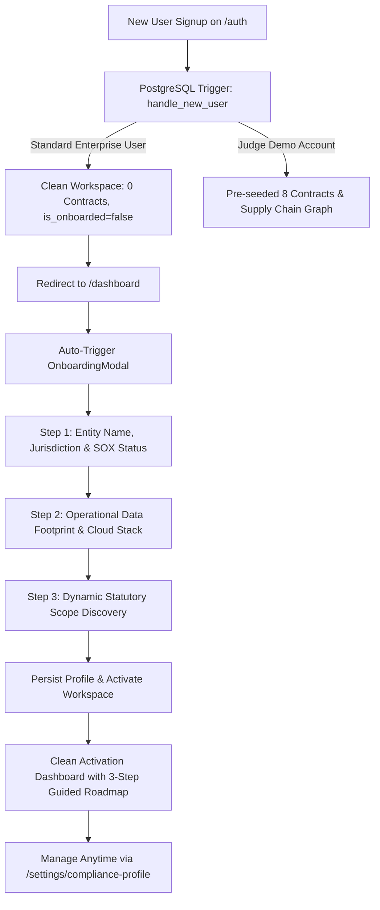

# ClauseGraph: Enterprise Onboarding & Statutory Scope Engine

## 1. Overview
In legacy prototypes, every newly registered user workspace was forcibly pre-seeded with 8 sample contracts (representing a synthetic $66,970,000 valuation) and a hardcoded supply chain graph. For production enterprise deployments, this approach was problematic because the system presented synthetic data prior to learning the organization's legal identity and operating footprint.

The onboarding and compliance engine completely eliminates synthetic assumptions through a **3-Step Enterprise Onboarding Wizard**, **Dynamic Statutory Deduction Engine**, **Clean Activation Dashboard**, and **Lifecycle Compliance Profile Settings**.

---

## 2. Architecture & Core Components



### Component 1: 3-Step Enterprise Onboarding Wizard (`src/components/clausegraph/OnboardingModal.tsx`)
- **Step 1: Organization & Jurisdiction**:
  - Official legal entity name (`entity_name`).
  - Headquarters or primary country of incorporation (`headquarters_country` - e.g., Bangladesh, United States, Germany, United Kingdom).
  - Publicly traded entity toggle (`is_publicly_traded`) — automatically enforces US **Sarbanes-Oxley (SOX §302/§404)** corporate governance and audit retention mandates.
- **Step 2: Operational Data Footprint & Cloud Infrastructure**:
  - `processes_eu_data`: Processing of European resident personal data (activates **EU GDPR** Article 5, Article 33 breach notifications, Article 44 cross-border transfer rules).
  - `processes_digital_payments`: Digital transactions, banking APIs, or payment gateways (activates **Bangladesh Bank Digital Payment Security Guidelines 2023**).
  - `processes_us_health_data`: Protected Health Information (ePHI) processing (activates **HIPAA Security Rule** and mandatory Business Associate Agreements).
  - `processes_us_consumer_data`: California and US retail consumer operations (activates **CCPA/CPRA** consumer opt-out rules).
  - `develops_or_uses_ai`: Machine learning model development or high-risk algorithmic deployment (activates **EU AI Act 2024** conformity assessments).
  - `cloud_providers`: Multi-cloud infrastructure selection (AWS, Azure, GCP, On-Premise).
- **Step 3: Dynamic Statutory Scope Discovery**:
  - Based on the enterprise profile inputs, the system computes applicable governing statutes in real time and renders an interactive preview with official citation badges.
  - Clicking **Launch Clean Workspace** persists the profile and unlocks the enterprise dashboard.

---

### Component 2: Dynamic Statutory Scope Deduction Engine (`src/lib/compliance-profile.functions.ts`)
- The `deduceApplicableFrameworks(profile)` engine evaluates deterministic, rule-based statutory mappings:
  1. **Domestic Anchor**: Entities domiciled in Bangladesh automatically bind to the `Cyber Security Ordinance 2025` and the `Labour Act 2006 (§26 Notice & Statutory Dues)`.
  2. **EU Processing**: If `processes_eu_data` is true, binds `REG-GDPR-5`, `REG-GDPR-33`, and `REG-GDPR-44`.
  3. **Digital Payments**: If `processes_digital_payments` is true, binds `REG-BB-DPS-2023`.
  4. **US Health Data**: If `processes_us_health_data` is true, binds `REG-HIPAA-SEC`.
  5. **US Consumers**: If `processes_us_consumer_data` is true, binds `REG-CCPA-1798.120`.
  6. **AI Development**: If `develops_or_uses_ai` is true, binds `REG-EU-AIACT-2024`.
  7. **Publicly Traded**: If `is_publicly_traded` is true, binds `REG-SOX-302` and `REG-SEC-17A4`.

---

### Component 3: Clean Activation Dashboard (`src/routes/_authenticated/dashboard.tsx`)
When a new organization registers without prior uploaded agreements (`contracts.length === 0`), the dashboard avoids synthetic charts and instead renders a clean activation roadmap:
1. **0 Monitored Agreements**: Displays zero synthetic portfolio values.
2. **Organization Scope Active Banner**: Displays the verified legal entity name, industry vertical, primary domicile, cloud architecture, and active statutory count.
3. **3-Step Guided Roadmap**:
   - `Step 1 (Completed)`: Compliance Scope Defined — Profile configured. Counsel can reconfigure parameters at any time via the `Reconfigure Profile` trigger.
   - `Step 2 (Action Required)`: Upload Your First Agreement — Primary CTA guiding users to ingest production contract PDFs.
   - `Step 3 (Next)`: Simulate Blast Radius — Prepared to execute stress tests once contracts are ingested.
4. **Active Regulatory Frameworks Grid**: Direct interactive view of governing statutory regimes customized for the organization.

---

### Component 4: Compliance Scope Settings (`src/routes/_authenticated/settings.compliance-profile.tsx`)
- Dedicated **Compliance Scope** settings tab located in the primary navigation sidebar.
- Counsel can update operational footprint switches at any stage of the enterprise lifecycle.
- **Live Mapping**: Adjusting toggles immediately recalculates the active statutory framework list on the right pane in real time.
- **Save Changes**: Persists modifications atomically to PostgreSQL and triggers confirmation toast alerts.

---

## 3. Database Schema & Automated Trigger Logic

### Migration: `supabase/migrations/20260726150000_organization_compliance_profile.sql`

```sql
CREATE TABLE IF NOT EXISTS public.organization_compliance_profiles (
  org_id UUID PRIMARY KEY REFERENCES public.organizations(id) ON DELETE CASCADE,
  entity_name TEXT NOT NULL,
  headquarters_country TEXT NOT NULL DEFAULT 'BD',
  is_publicly_traded BOOLEAN NOT NULL DEFAULT false,
  industry_vertical TEXT NOT NULL DEFAULT 'saas',
  processes_eu_data BOOLEAN NOT NULL DEFAULT false,
  processes_us_health_data BOOLEAN NOT NULL DEFAULT false,
  processes_us_consumer_data BOOLEAN NOT NULL DEFAULT false,
  processes_digital_payments BOOLEAN NOT NULL DEFAULT false,
  develops_or_uses_ai BOOLEAN NOT NULL DEFAULT false,
  cloud_providers TEXT[] NOT NULL DEFAULT ARRAY['aws'],
  active_framework_ids TEXT[] NOT NULL DEFAULT '{}',
  is_onboarded BOOLEAN NOT NULL DEFAULT false,
  created_at TIMESTAMPTZ NOT NULL DEFAULT now(),
  updated_at TIMESTAMPTZ NOT NULL DEFAULT now()
);
```

### Updated Trigger Logic (`handle_new_user`):
```sql
is_demo_user := (LOWER(NEW.email) = 'judge@clausegraph.ai');

-- ONLY seed sample contracts & supply chain for the official demo judge account!
IF is_demo_user THEN
  FOR s_contract IN SELECT * FROM public.sample_contracts ORDER BY position LOOP
    INSERT INTO public.contracts (...) VALUES (...);
  END LOOP;
  PERFORM public.seed_supply_chain(new_org_id);
END IF;
```

---

## 4. Code File Architecture Map

| File Path | Functional Responsibility |
| :--- | :--- |
| `src/components/clausegraph/OnboardingModal.tsx` | 3-step modal interface for organization profile configuration |
| `src/lib/compliance-profile.functions.ts` | Backend statutory deduction rules and profile synchronization logic |
| `src/routes/_authenticated/dashboard.tsx` | Clean cold-start activation dashboard and onboarding guard |
| `src/routes/_authenticated/settings.compliance-profile.tsx` | Lifecycle compliance scope settings and live framework mapper |
| `src/components/clausegraph/Sidebar.tsx` | Sidebar navigation link integration |
| `src/data/queries.ts` | React Query data caching and fetching layer |
