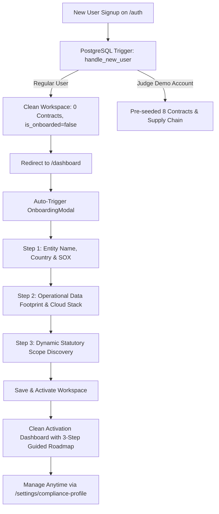

# ClauseGraph: Enterprise Onboarding & Statutory Scope Engine

## ১. ওভারভিউ (Overview)
পূর্ববর্তী ভার্সনে প্রতিটি নতুন সাইন-আপে জোরপূর্বক ৮টি ডামি কন্ট্রাক্ট ($66,970,000 ভ্যালুয়েশন) এবং কাল্পনিক সাপ্লাই চেইন গ্রাফ পুশ করা হতো। এটি রিয়েল-ওয়ার্ল্ড এন্টারপ্রাইজ ব্যবহারের জন্য অগ্রহণযোগ্য ছিল, কারণ সিস্টেম কোম্পানি সম্পর্কে কিছু না জেনেই মিথ্যা ডেটা উপস্থাপন করতো।

ব্রাঞ্চ **`user_onboarding_shovon`**-এ এই সমস্যাটি পুরোপুরি দূর করে একটি বাস্তবমুখী **৩-ধাপের Onboarding Wizard**, **Dynamic Statutory Deduction Engine**, **Clean Activation Dashboard** এবং **Lifecycle Compliance Profile Settings** তৈরি করা হয়েছে।

---

## ২. আর্কিটেকচার ও মূল উপাদানসমূহ



### উপাদান ১: ৩-ধাপের Onboarding Wizard (`src/components/clausegraph/OnboardingModal.tsx`)
- **ধাপ ১: Organization & Jurisdiction**:
  - কোম্পানির আইনগত নাম (`entity_name`)।
  - হেডকোয়ার্টার বা ইনকর্পোরেশন দেশ (`headquarters_country` - বাংলাদেশ, যুক্তরাষ্ট্র, জার্মানি, ফ্রান্স ইত্যাদি)।
  - পাবলিকলি ট্রেডেড লিস্টিং টগল (`is_publicly_traded`) — যা মার্কিন **Sarbanes-Oxley (SOX §302/§404)** অডিট কন্ট্রোল কার্যকর করে।
- **ধাপ ২: Operational Data Footprint & Cloud Stack**:
  - `processes_eu_data`: ইউরোপীয় নাগরিকদের ডেটা প্রসেসিং (সক্রিয় করে **EU GDPR** Article 5, 33 breach notice, 44 transfer)।
  - `processes_digital_payments`: ডিজিটাল ট্রানজ্যাকশন ও পেমেন্ট (সক্রিয় করে **Bangladesh Bank Digital Payment Security Guidelines 2023**)।
  - `processes_us_health_data`: সুরক্ষিত স্বাস্থ্য তথ্য বা ePHI (সক্রিয় করে **HIPAA Security Rule** ও BAA বাধ্যবাধকতা)।
  - `processes_us_consumer_data`: ক্যালিফোর্নিয়া/মার্কিন কনজিউমার রিটেল (সক্রিয় করে **CCPA/CPRA** opt-out)।
  - `develops_or_uses_ai`: এআই/এলএলএম মডেল ট্রেইনিং ও ডেপ্লয়মেন্ট (সক্রিয় করে **EU AI Act 2024** conformity checks)।
  - `cloud_providers`: AWS, Azure, GCP, On-Premise মাল্টি-সিলেক্ট।
- **ধাপ ৩: Dynamic Statutory Scope Discovery**:
  - পূর্ববর্তী তথ্যের ওপর ভিত্তি করে সিস্টেম রিয়েল-টাইমে প্রযোজ্য আইনগুলো শনাক্ত করে এবং সাইটেশন ও দেশ ব্যাজসহ প্রিভিউ দেখায়।
  - **Launch Clean Workspace** বোতাম চাপলে প্রোফাইল ডাটাবেজে পারসিস্ট হয়।

---

### উপাদান ২: Dynamic Statutory Scope Deduction Engine (`src/lib/compliance-profile.functions.ts`)
- `deduceApplicableFrameworks(profile)` ফাংশনটি নিয়মভিত্তিক ডিটারমিনিস্টিক লজিক প্রয়োগ করে:
  1. **Domestic Anchor**: বাংলাদেশ ডোমিসাইল হলে স্বয়ংক্রিয়ভাবে `Cyber Security Ordinance 2025` এবং `Labour Act 2006 (§26 Notice & Dues)` সংযুক্ত হয়।
  2. **EU Processing**: `processes_eu_data` সত্য হলে `REG-GDPR-5`, `REG-GDPR-33`, `REG-GDPR-44` সংযুক্ত হয়।
  3. **Digital Payments**: `processes_digital_payments` সত্য হলে `REG-BB-DPS-2023` সংযুক্ত হয়।
  4. **US Health Data**: `processes_us_health_data` সত্য হলে `REG-HIPAA-SEC` সংযুক্ত হয়।
  5. **US Consumers**: `processes_us_consumer_data` সত্য হলে `REG-CCPA-1798.120` সংযুক্ত হয়।
  6. **AI Development**: `develops_or_uses_ai` সত্য হলে `REG-EU-AIACT-2024` সংযুক্ত হয়।
  7. **Publicly Traded**: `is_publicly_traded` সত্য হলে `REG-SOX-302` ও `REG-SEC-17A4` সংযুক্ত হয়।

---

### উপাদান ৩: Clean Activation Dashboard (`src/routes/_authenticated/dashboard.tsx`)
যখন ব্যবহারকারীর কোনো কন্ট্রাক্ট আপলোড করা থাকে না (`contracts.length === 0`), তখন কোনো ফেক গ্রাফ বা ডামি চার্ট প্রদর্শনের পরিবর্তে একটি বাস্তব অ্যাক্টিভেশন রোডম্যাপ প্রদর্শিত হয়:
1. **0 Monitored Agreements**: কোনো মিথ্যা ভ্যালুয়েশন নেই।
2. **Organization Scope Active Banner**: কোম্পানির নাম, সেক্টর, ডোমিসাইল, ক্লাউড স্ট্যাক এবং ইন-স্কোপ আইনের সংখ্যা প্রদর্শিত হয়।
3. **৩-ধাপের গাইডেড রোডম্যাপ**:
   - `Step 1 (Active/Done)`: Compliance Scope Defined — প্রোফাইল কনফিগার সম্পন্ন। `Reconfigure Profile` বাটন দিয়ে যে কোনো সময় এডিট করা যায়।
   - `Step 2 (Action Required)`: Upload Your First Agreement — প্রাইমারি অ্যাকশন বাটন যা আসল কন্ট্রাক্ট PDF আপলোডের পথ দেখায়।
   - `Step 3 (Next)`: Simulate Blast Radius — কন্ট্রাক্ট যোগ হলে ব্লাস্ট রেডিয়াস সিমুলেশন চালানোর প্রস্তুতি।
4. **Active Regulatory Frameworks Grid**: কোম্পানির জন্য প্রযোজ্য আইনগুলোর সরাসরি ইন্টার‍্যাক্টিভ প্রিভিউ।

---

### উপাদান ৪: Compliance Scope Settings পেজ (`src/routes/_authenticated/settings.compliance-profile.tsx`)
- সাইডবারে নতুন **Compliance Scope** মেনু আইটেম।
- কোম্পানির অপারেশনাল ফুটপ্রিন্টের প্রতিটি সুইচ পরবর্তীতে যে কোনো সময় পরিবর্তন করার পূর্ণ সুবিধা।
- **Live Mapping**: বামপাশে সুইচ টগল করা মাত্রই ডানপাশে রিয়েল-টাইমে অ্যাক্টিভ আইনের তালিকা আপডেট হয়ে যায়।
- **Save Changes**: এক ক্লিকে ডাটাবেজে সংরক্ষণ হয় এবং Sonner টোস্ট ফিডব্যাক প্রদান করে।

---

## ৩. ডাটাবেজ স্কিমা ও ট্রিগার লজিক

### মাইগ্রেশন ফাইল: `supabase/migrations/20260726150000_organization_compliance_profile.sql`

```sql
CREATE TABLE IF NOT EXISTS public.organization_compliance_profiles (
  org_id UUID PRIMARY KEY REFERENCES public.organizations(id) ON DELETE CASCADE,
  entity_name TEXT NOT NULL,
  headquarters_country TEXT NOT NULL DEFAULT 'BD',
  is_publicly_traded BOOLEAN NOT NULL DEFAULT false,
  industry_vertical TEXT NOT NULL DEFAULT 'saas',
  processes_eu_data BOOLEAN NOT NULL DEFAULT false,
  processes_us_health_data BOOLEAN NOT NULL DEFAULT false,
  processes_us_consumer_data BOOLEAN NOT NULL DEFAULT false,
  processes_digital_payments BOOLEAN NOT NULL DEFAULT false,
  develops_or_uses_ai BOOLEAN NOT NULL DEFAULT false,
  cloud_providers TEXT[] NOT NULL DEFAULT ARRAY['aws'],
  active_framework_ids TEXT[] NOT NULL DEFAULT '{}',
  is_onboarded BOOLEAN NOT NULL DEFAULT false,
  created_at TIMESTAMPTZ NOT NULL DEFAULT now(),
  updated_at TIMESTAMPTZ NOT NULL DEFAULT now()
);
```

### আপডেটেড ট্রিগার লজিক (`handle_new_user`):
```sql
is_demo_user := (LOWER(NEW.email) = 'judge@clausegraph.ai');

-- ONLY seed sample contracts & supply chain for the official demo judge account!
IF is_demo_user THEN
  FOR s_contract IN SELECT * FROM public.sample_contracts ORDER BY position LOOP
    INSERT INTO public.contracts (...) VALUES (...);
  END LOOP;
  PERFORM public.seed_supply_chain(new_org_id);
END IF;
```

---

## ৪. কোড ফাইল মানচিত্র (Code File Map)

| ফাইল পাথ | দায়িত্ব |
| :--- | :--- |
| `src/components/clausegraph/OnboardingModal.tsx` | ৩-ধাপের অনবোর্ডিং পপআপ ইন্টারফেস |
| `src/lib/compliance-profile.functions.ts` | ব্যাকএন্ড ডিডাকশন ও প্রোফাইল সিঙ্কিং সার্ভার ফাংশন |
| `src/routes/_authenticated/dashboard.tsx` | ক্লিন কোল্ড-স্টার্ট ড্যাশবোর্ড ও অনবোর্ডিং গার্ড |
| `src/routes/_authenticated/settings.compliance-profile.tsx` | লাইফসাইকেল কমপ্লায়েন্স স্কোপ সেটিংস পেজ |
| `src/components/clausegraph/Sidebar.tsx` | সাইডবার নেভিগেশন ইন্টিগ্রেশন |
| `src/data/queries.ts` | রিঅ্যাক্ট কোয়েরি ক্যাশিং ও ডেটা ফেচিং লেয়ার |
