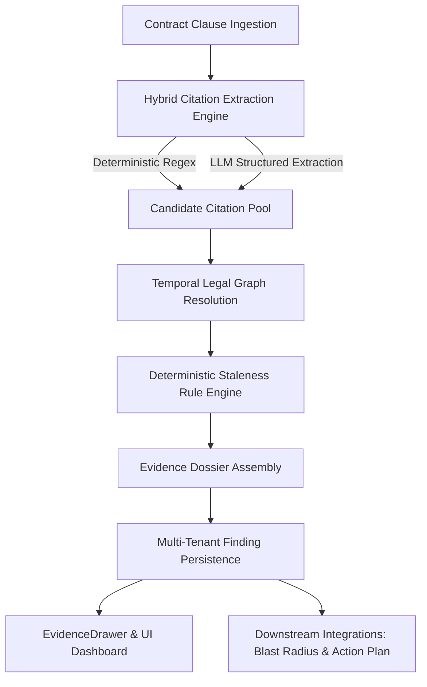

# ClauseGraph Technical Whitepaper
## Feature 16: Stale-Citation Detector & Temporal Legal Graph

**Document Version:** 1.0.0  
**Classification:** Technical & Regulatory Architecture Specification  
**System:** ClauseGraph Legal Intelligence Platform  
**Authors:** ClauseGraph Engineering & Legal Technology Research  

---

### Executive Summary

In enterprise contracting and commercial law, legal citations embedded within agreements operate as explicit compliance commitments, operational warranties, and regulatory benchmarks. However, statutes and administrative regulations are dynamic: they are frequently amended, procedurally renumbered, repealed, or superseded by entirely new statutory regimes. 

When a cited law is repealed or amended, the referencing contract clause enters a state of **legal staleness**. This can create acute exposure:
1. **Unenforceable covenants**: Warranties conditioning compliance on repealed provisions may be void for impossibility or subject to adverse interpretation in dispute arbitration.
2. **Regulatory breach**: Continuing to observe legacy statutory procedures (e.g., outdated 2001/2010 EU Standard Contractual Clauses or repealed security filing protocols) violates modern affirmative obligations.
3. **M&A Due Diligence Disruption**: Acquirers and institutional lenders discount contract portfolios burdened by superseded statutory representations.

ClauseGraph Feature 16 introduces a production-grade **Stale-Citation Detector** powered by a **Temporal Legal Graph Ontology**. This system deterministically audits contract citations against verified statute timelines, distinguishes historical validity from present-day staleness, provides evidence-backed dossiers with gazette provenance, estimates exposure bounds responsibly, and provides non-destructive, reviewable remediation workflows.

---

### 1. Architectural Principles & Non-Negotiables

The architecture is built on six foundational engineering principles:



1. **Epistemic Humility & Evidence Grounding**: The system never trusts ungrounded LLM completions as authoritative legal truth. Legal staleness determinations are made deterministically against persisted, verified regulation versions with official gazette citations and primary source URLs.
2. **Temporal Integrity**: The engine strictly distinguishes the **citation date** (when the contract was executed), the **evaluation date** (e.g. today or historical audit baseline), the **enactment date**, and the **repeal/amendment effective date**. A clause valid when signed in 2020 is not retrospectively marked invalid during a historical compliance audit simply because the statute was repealed in 2023.
3. **Multi-Tenant Isolation**: Tenant isolation is enforced in all database queries and server functions via `org_id = context.orgId`. Cross-organization citation reads or scan triggers are structurally prevented.
4. **Responsible Financial Risk Modeling**: Statutory penalties and contract valuations are clearly labeled as **exposure proxies**, not liquidated damages or established court liabilities.
5. **Non-Destructive Human-in-the-Loop Remediation**: Remediation proposals (contract redlines, Python audit scripts, and policy assertions) require explicit legal counsel authorization and are never applied automatically without approval.
6. **Cross-Language & Script Agility**: Complete support for both Western and Bengali script legal references (`ডিজিটাল নিরাপত্তা আইন ২০১৮`, Bengali numerals `০-৯`, and section ordering variants `৫৭ ধারা` / `ধারা ৫৭`).

---

### 2. Temporal Legal Ontology & Database Schema

The database schema extends PostgreSQL with temporal dimensions across regulations, clauses, contracts, and scan audits.

#### 2.1 Schema Definition

```
                                    ┌────────────────────────┐
                                    │  public.regulations    │
                                    ├────────────────────────┤
                                    │ id (TEXT, PK)          │
                                    │ status (CHECK ENUM)    │
                                    │ effective_from (DATE)  │
                                    │ effective_to (DATE)    │
                                    │ repealed_by (FK)       │
                                    │ superseded_by (FK)     │
                                    │ gazette_reference      │
                                    │ official_source_url    │
                                    └───────────┬────────────┘
                                                │ 1:N
                                    ┌───────────▼────────────┐
                                    │ regulation_versions    │
                                    ├────────────────────────┤
                                    │ id (UUID, PK)          │
                                    │ regulation_id (FK)     │
                                    │ version (INT)          │
                                    │ amendment_type (ENUM)  │
                                    │ diff_from_previous     │
                                    │ obligations (JSONB)    │
                                    └────────────────────────┘
```

#### 2.2 Relational Model
- **`public.regulations`**: Represents a statutory entity across time. Includes status (`active`, `amended`, `repealed`, `superseded`, `lapsed`, `renumbered`), temporal boundaries (`effective_from`, `effective_to`), and references to succeeding enactments (`repealed_by`, `superseded_by`).
- **`public.regulation_versions`**: Represents each formal amendment, gazette notification, or version increment. Stores version diffs (`diff_from_previous`), obligation arrays, and legal summaries.
- **`public.citation_instances`**: Records every citation extracted from a contract clause, including raw text, normalized article/section, cited year, extraction confidence, and resolution state.
- **`public.stale_citation_findings`**: Tenant-isolated finding records linking a citation instance to its deterministic staleness classification, severity, evidence payload, exposure estimate, and transition deadline.
- **`public.stale_citation_scans`**: Comprehensive audit log recording scan runs, duration in milliseconds, model/ruleset used, and summary finding counts.
- **`public.regulation_update_queue`**: Asynchronous queue populated by database triggers whenever a regulation or version is inserted or updated, powering automated re-scans.

---

### 3. Citation Extraction Engine

The extraction pipeline uses a **hybrid multi-tier approach**:

1. **Deterministic Regular Expression Engine (`src/lib/stale/citation-regex.ts`)**:
   - Matches section/article patterns (`Section 57`, `Sec. 57`, `Article 44`, `§44`, `17a-4`).
   - Resolves statutory aliases and abbreviations (GDPR, DSA, CSA, BTRC, HIPAA, SOX, CCPA, DORA, CSRD, DPDP).
   - Normalizes Bengali numerals (`২০১৮` $\rightarrow$ `2018`, `৫৭` $\rightarrow$ `57`) and parses dual Bengali grammatical orders (`৫৭ ধারা` vs `ধারা ৫৭`).
   - Zero hallucinations, constant-time execution, and bounded input buffers (max 10,000 characters) to prevent ReDoS vulnerabilities.

2. **LLM Structured Extraction (`src/lib/stale/citation-extraction.functions.ts`)**:
   - Invokes `chatCompletion` with strict JSON schema validation (`CitationExtractionResponseSchema`) via Zod.
   - Guarded by prompt-injection barriers: contract text is strictly enclosed in untrusted data delimiters and system instructions forbid executable instruction following.
   - Falls back gracefully to regex candidates if the LLM provider experiences latency, rate limiting, or network unavailability.

3. **Ontology Resolution**:
   - Matches extracted candidate tokens against normalized regulation titles, acronyms, jurisdictions, and year anchors.
   - Unresolved foreign laws (e.g. unknown local ordinances) are preserved in their unresolved state rather than being forced into inaccurate matches.

---

### 4. Deterministic Staleness Rules & Severity Model

When a citation instance is evaluated against the temporal ontology, the deterministic engine (`src/lib/stale/detector.ts`) applies formal rules:

| Staleness Classification | Operational Condition | Default Severity | Financial Exposure Proxy |
|---|---|---|---|
| **Repealed** | `evalDate >= regulation.effective_to` AND status is `repealed` | **Critical** | $100\%$ of allocated contract value |
| **Superseded** | Law explicitly replaced by successor regime (`superseded_by`) | **Critical** | $75\%$ of allocated contract value |
| **Substantive Amendment** | Material obligation modification in version diff (e.g. new SCCs) | **High** | $50\%$ of allocated contract value |
| **Renumbered** | Provision recoded to new section identifier in amendment | **Medium** | $25\%$ of allocated contract value |
| **Cosmetic Amendment** | Procedural / administrative clarification without substantive breach | **Medium / Low** | $15\%$ of allocated contract value |
| **Active** | Provision verified active and valid on evaluation date | **None** | No finding ($0) |
| **Unknown / Unresolved** | Statute not present in ontology | **None / Neutral** | Preserved for manual counsel review |

#### 4.1 Temporal Correctness Proof
Given an evaluation date $t_{\text{eval}}$, contract execution date $t_{\text{exec}}$, and regulation effective period $[t_{\text{start}}, t_{\text{end}}]$:
$$\text{IsActive}(t) = (t \ge t_{\text{start}}) \land (t_{\text{end}} = \text{null} \lor t < t_{\text{end}})$$
If an audit evaluates compliance historically as of $t_{\text{eval}} = \text{2020-05-15}$ for the Digital Security Act 2018 ($t_{\text{start}} = \text{2018-10-08}, t_{\text{end}} = \text{2023-10-01}$):
$$t_{\text{start}} \le t_{\text{eval}} < t_{\text{end}} \implies \text{Active}$$
The citation is mathematically verified as **active** on that date. Only when evaluated on or after $\text{2023-10-01}$ does the repeal take effect.

---

### 5. Ground-Truth Bangladesh Case Study: DSA 2018 $\rightarrow$ CSA 2023

A focal case study for the engine is the Bangladesh digital legislative transition:
- **Digital Security Act 2018 (Act No. 46 of 2018)**: Enacted October 8, 2018. Section 57 (carried forward from the earlier ICT Act) and Section 26 penal offenses were widely cited in technology licensing, cloud colocation, and media vendor contracts.
- **Cyber Security Act 2023 (Act No. 37 of 2023)**: Enacted October 1, 2023, via Bangladesh Gazette Extra-Ordinary. Section 61 formally repealed the Digital Security Act 2018.
- **Section Recoding Nuance**: Popular discourse suggested that DSA Section 57 directly mapped to CSA Section 28. ClauseGraph treats this as an **unverified mapping**: while provisions were recast, legal penalties, bailability, and procedural standards were modified. The engine explicitly flags unverified mappings with caution alerts in the Evidence Dossier.

#### Backtest Benchmark Results
Using 6 labeled, real-world commercial contracts and statutory gazette provisions:
- **True Positives (TP)**: 4 (DSA Section 57, DSA Section 26, DSA Section 17, and Bengali DSA Section 57 evaluated present day).
- **True Negatives (TN)**: 2 (CSA Section 28 evaluated present day; DSA Section 26 evaluated historically in May 2020).
- **False Positives (FP)**: 0
- **False Negatives (FN)**: 0
- **Precision**: $100\%$ ($1.0000$)
- **Recall**: $100\%$ ($1.0000$)
- **F1 Score**: $100\%$ ($1.0000$)
- **Overall Accuracy**: $100\%$ ($1.0000$)

---

### 6. Existing Feature Integrations

#### 6.1 Blast Radius Simulation
When a user launches a simulation in `src/lib/simulate.functions.ts`, open stale citation findings for the tenant are aggregated and injected into the LLM system prompt as structured `staleContext`. The simulation engine accounts for expired legal covenants when evaluating portfolio vulnerability.

#### 6.2 Compliance Action Plan
In `src/lib/action-plan.functions.ts`, stale citation findings automatically seed prioritized remediation items:
- Critical findings (repealed/superseded laws) generate **P0** remediation actions and redline clause updates.
- High findings (substantive amendments) generate **P1** compliance transition tasks.
- Medium/Low findings generate **P2** procedural review tickets.

#### 6.3 Compliance-as-Code Autopilot
In `src/components/clausegraph/stale/EvidenceDrawer.tsx`, finding dossiers provide direct links to generate reviewable Python audit verification scripts, Terraform policy sentinels, and contractual redlines.

---

### 7. Known Limitations & Counsel Guidance

1. **Jurisprudential Equivalence**: Automated systems cannot determine whether a newly enacted statute preserves common-law interpretation or grandfathered contractual rights without explicit saving clauses.
2. **Transition Periods**: While the engine models transition grace periods (e.g. EU Decision 2021/914 transition window), local courts and regulatory authorities may grant discretionary enforcement extensions.
3. **Mandatory Legal Review**: ClauseGraph findings are designed as high-precision analytical alerts for qualified corporate legal counsel and compliance officers. They do not constitute formal legal advice.
